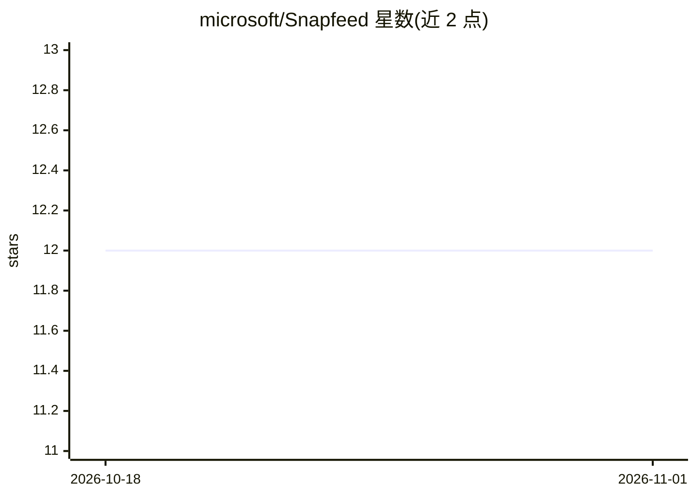

# microsoft/Snapfeed

⭐ 12 · TypeScript · MIT · 推送 2026-10-29 · [GitHub](https://github.com/microsoft/Snapfeed) · 组织维护

**为 AI agent 开发闭环采集 UI 反馈与遥测的 Web 库**

微软开源的 TypeScript 客户端库与配套服务器：在 Web 应用中一行接入，自动捕获点击、SPA 路由变化、控制台错误、API/网络失败等事件，用户 Cmd+Click 提交带标注截图的反馈；事件以结构化遥测形式存入后端（Hono/FastAPI + SQLite），供 AI agent 或开发团队查询以迭代修复 UI 代码。提供插件机制补充组件名与源码位置，适配器可转发反馈至 GitHub Issues/Slack/Telegram/webhook，支持自建后端与自定义 UI。要求 Node.js 20.19.0+ 或 22.12.0+；公开应用需自建鉴权中继。

## 筛选速览

| 维度 | 判定 | 备注 |
|---|---|---|
| AI 角色 | `ai-ecosystem` | LLM/agent 周边工具 |
| 许可风险 | `permissive` | MIT |
| 部署形态 | `library` | 以包/库形式分发 |
| 模型依赖 | — | README 未给出锁定关系 |
| 硬件要求 | — | 无带数字的原话,不猜 |
| 安装摩擦 | `low` | 无编译、无系统依赖或容器化 |
| 成熟度 | — | 结构信号不足 |

## 能力要点

- 自动捕获点击/导航/错误/API 失败六类遥测事件
- Cmd+Click 提交带标注截图与页面上下文的反馈
- 插件为点击事件附加组件名与源码文件位置
- 适配器转发反馈至 GitHub Issues/Slack/Telegram/webhook

## 适用场景

- AI agent 写 UI 代码后，我提交截图反馈让它修复迭代
- 生产应用中收集用户带截图反馈进入队列，由 agent 或团队分派处理
- 为 agent 提供可查询的结构化 UI 遥测数据

## 场景标签

 · 领域:开发者工具/Web 遥测

## 证据(README 行号)

> L20: AI agents can write UI code, but they can't _see_ the result. Snapfeed gives
> L27: The agent writes code. You test. When something's off, **Cmd+Click** anywhere

## 星数曲线

2026-10-18 12 → 2026-11-01 12（+0）

---
*卡片 v1 · prompt 1.4 · 生成 2026-11-01 · 置信度 mid · 依据 README sha `d5967b10409c` · [字段定义](../../DATASET.md)*
