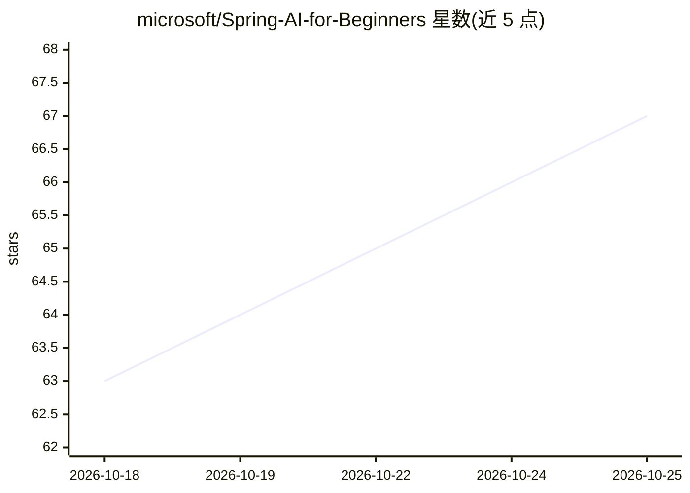

# microsoft/Spring-AI-for-Beginners

⭐ 67 · Java · MIT · 推送 2026-09-10 · [GitHub](https://github.com/microsoft/Spring-AI-for-Beginners) · 组织维护

**面向 Java 开发者的 Spring AI 课程：从聊天到 RAG 与 Agent**

微软维护的端到端教学课程，带 Java 开发者从基础 LLM 调用进阶到面向生产形态的 AI 模式（RAG、工具调用、MCP、Agent），基于 Spring AI + Azure 技术栈。通过 GitHub Codespaces 开发容器一键搭建学习环境，azd up 预置一个聊天模型（gpt-5.6-luna）与一个嵌入模型（text-embedding-3-small）部署，各模块经环境变量路由到对应部署。每个代码示例附带可问 GitHub Copilot 的建议问题。课程需 Azure 账号并使用 Microsoft Foundry。

## 筛选速览

| 维度 | 判定 | 备注 |
|---|---|---|
| AI 角色 | `ai-knowledge` | 知识聚合/清单类 |
| 许可风险 | `permissive` | MIT |
| 部署形态 | `None` |  |
| 模型依赖 | — | README 未给出锁定关系 |
| 硬件要求 | — | 无带数字的原话,不猜 |
| 安装摩擦 | `low` | 无编译、无系统依赖或容器化 |
| 成熟度 | — | 结构信号不足 |

## 能力要点

- 覆盖从基础聊天到 RAG、工具、MCP、Agent 的课程路径
- Codespaces 开发容器预配置环境，5-10 分钟就绪
- azd up 预置聊天与嵌入两个模型部署，经环境变量路由
- 代码示例含建议向 GitHub Copilot 提问的学习提示

## 适用场景

- Java 开发者系统学习 Spring AI 构建生成式 AI 应用
- 学习 RAG、MCP、Agent 等生产级 AI 模式的实现
- 在预配置 Codespace 环境中跟随模块动手实践

## 场景标签

`教程课程` · 领域:学习与行业

## 证据(README 行号)

> L5: An end-to-end curriculum that takes a Java developer from "hello, LLM" to production-shaped AI patterns (RAG, tools,
> L22: > **Models used:** `azd up` provisions two model deployments — one chat model and one embedding model. Every module

## 星数曲线

2026-10-18 63 → 2026-10-25 67（+4）

---
*卡片 v1 · prompt 1.4 · 生成 2026-10-24 · 置信度 high · 依据 README sha `894d6b4232f6` · [字段定义](../../DATASET.md)*
