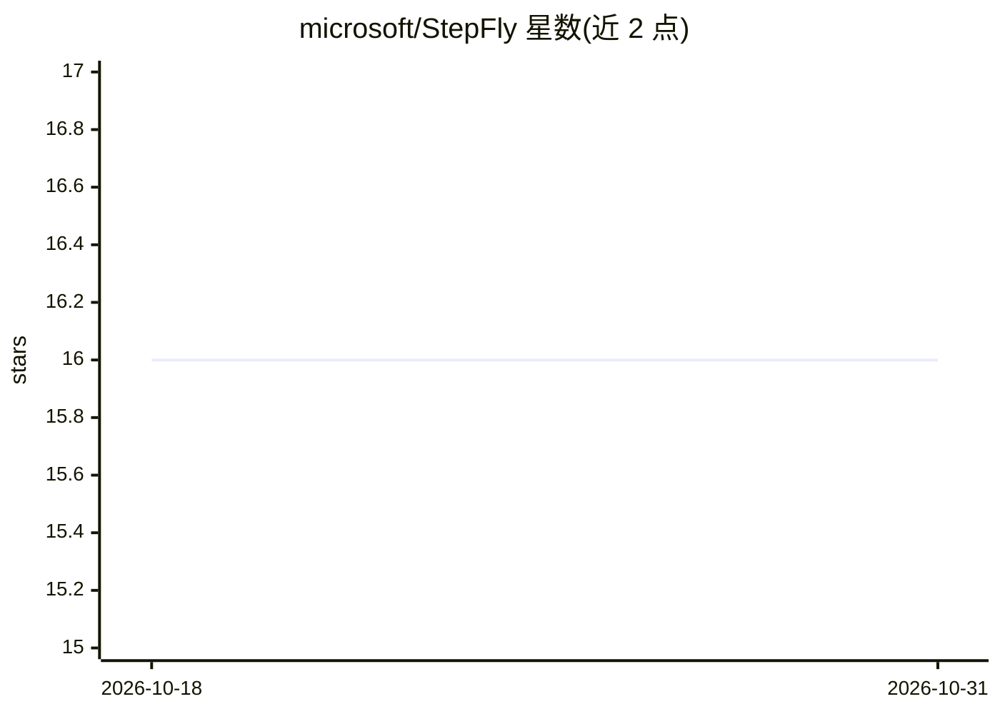

# microsoft/StepFly

⭐ 16 · Python · MIT · 推送 2026-06-01 · [GitHub](https://github.com/microsoft/StepFly) · 组织维护

**多 LLM agent 协作自动执行排障指南（TSG）的事件诊断框架**

微软开源的排障指南自动化框架：Scheduler agent 依据 PlanDAG（有向无环图）编排排障流程，多个 Executor agent 并行执行各诊断步骤，支持插件扩展、agent 间持久记忆与上下文共享，并提供 Web 面板实时可视化 DAG 执行。排障知识以 TSG 文档形式沉淀。面向运维/事件诊断场景的开发者与科研用户，属研究原型，作者建议生产环境使用前充分测试。支持任何兼容 OpenAI API 格式的 LLM 提供方。

## 筛选速览

| 维度 | 判定 | 备注 |
|---|---|---|
| AI 角色 | `ai-ecosystem` | LLM/agent 周边工具 |
| 许可风险 | `permissive` | MIT |
| 部署形态 | `None` |  |
| 模型依赖 | — | README 未给出锁定关系 |
| 硬件要求 | — | 无带数字的原话,不猜 |
| 安装摩擦 | `low` | 无编译、无系统依赖或容器化 |
| 成熟度 | `idea` | |

## 能力要点

- Scheduler-Executor 多 agent 架构，Executor 可并行执行诊断步骤
- 基于 PlanDAG 的条件逻辑与并行执行工作流
- 可从 TSG 文档集成的插件系统与跨 agent 记忆管理
- Web 面板实时可视化排障会话与 DAG 执行

## 适用场景

- 我在运维团队想把人工排障知识沉淀为 TSG 并自动执行
- 多区域服务事件需要并行多步骤系统性诊断
- 在 Web 面板上实时监控 agent 排障进度并定位根因

## 场景标签

`多智能体` · 领域:Agent 开发

## 证据(README 行号)

> L8: StepFly is an **agentic troubleshooting guide (TSG) automation framework** for intelligent incident diagnosis. This 
> L10: Unlike traditional manual troubleshooting that relies heavily on engineer expertise, StepFly preserves institutiona

## 星数曲线

2026-10-18 16 → 2026-10-31 16（+0）

---
*卡片 v1 · prompt 1.4 · 生成 2026-10-30 · 置信度 high · 依据 README sha `46bd3141f991` · [字段定义](../../DATASET.md)*
