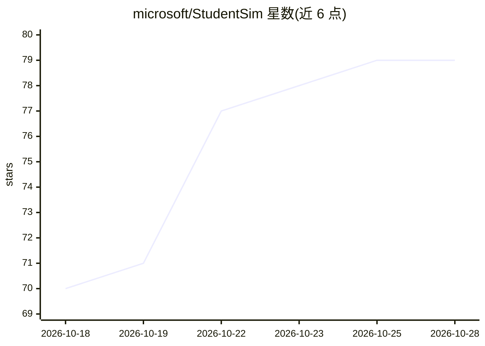

# microsoft/StudentSim

⭐ 79 · HTML · MIT · 推送 2026-10-22 · [GitHub](https://github.com/microsoft/StudentSim) · 组织维护

**为AI辅导研究者训练单个学生模拟器以测试辅导方法**

微软的研究框架：从稀疏学生记录出发，经跨学生池化训练（Stage 1 LoRA adapter）与单学生专门化（Stage 2 继续训练）为每名学生训练一个模拟器，覆盖国际象棋、二语英语写作、初中数学三个领域。模拟器强调行为保真度与对辅导的响应性，可在人类学生参与前测试辅导方法；国际象棋领域还演示了以冻结模拟器为强化学习环境训练AI导师。部分步骤需调用 Azure OpenAI 语言模型并产生 API 费用，tutor_rl 扩展依赖 libcairo。

## 筛选速览

| 维度 | 判定 | 备注 |
|---|---|---|
| AI 角色 | `ai-native` | 本体是模型或模型工具 |
| 许可风险 | `permissive` | MIT |
| 部署形态 | `library` | 以包/库形式分发 |
| 模型依赖 | — | README 未给出锁定关系 |
| 硬件要求 | — | 无带数字的原话,不猜 |
| 安装摩擦 | `low` | 无编译、无系统依赖或容器化 |
| 成熟度 | — | 结构信号不足 |

## 能力要点

- 两阶段训练（池化LoRA + 单学生专门化）生成每生一个模拟器
- 覆盖象棋/L2写作/初中数学三个领域
- 象棋领域以冻结模拟器为RL环境训练导师策略
- 提供 studentsim-train/eval 等命令行工具与可复现构建流程

## 适用场景

- 在招募真人学生前快速测试辅导策略效果
- 为AI家教研究构造可控的学生行为替身
- 研究模拟器的行为保真度与辅导响应性评估方法

## 场景标签

`微调` `强化学习` `科研工具` · 领域:学习与行业

## 证据(README 行号)

> L5: StudentSim builds per-student simulators for a practical problem in tutor improvement: learning which guidance helps
> L7: The repository trains one simulator per student from sparse student records, using pooled training followed by per-s
> L59: This trains one LoRA adapter on records pooled across many students in that domain.

## 星数曲线

2026-10-18 70 → 2026-10-28 79（+9）

---
*卡片 v1 · prompt 1.4 · 生成 2026-10-24 · 置信度 high · 依据 README sha `81980f778c3f` · [字段定义](../../DATASET.md)*
