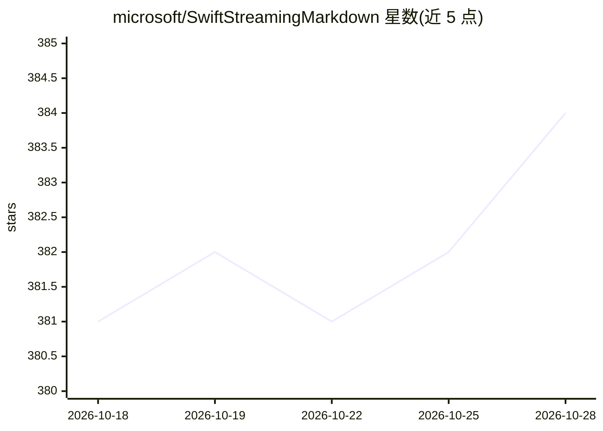

# microsoft/SwiftStreamingMarkdown

⭐ 387 · Swift · MIT · 推送 2026-10-16 · [GitHub](https://github.com/microsoft/SwiftStreamingMarkdown) · 组织维护

**iOS/macOS 流式 Markdown 渲染库，面向 LLM 输出展示**

微软开源的 SwiftUI Markdown 渲染库，以 Swift Package 分发，要求 Swift 5.9、iOS 16+、macOS 14+。面向在聊天式界面中增量渲染 LLM 流式回答的开发者：StreamedMarkdownView 接收逐步增大的 Markdown 快照并增量解析渲染，支持行内/块级 LaTeX、行内引用 UI、表格与代码块，不支持语法降级为可读文本。提供 MarkdownRenderConfig 主题定制与 MarkdownListener 事件监听，附示例 App。仅覆盖 LLM 常输出的 CommonMark+GFM 子集，脚注、原始 HTML、Mermaid 等尚不支持。

## 筛选速览

| 维度 | 判定 | 备注 |
|---|---|---|
| AI 角色 | `ai-ecosystem` | LLM/agent 周边工具 |
| 许可风险 | `permissive` | MIT |
| 部署形态 | `None` |  |
| 模型依赖 | — | README 未给出锁定关系 |
| 硬件要求 | — | 无带数字的原话,不猜 |
| 安装摩擦 | `medium` | 含编译或系统依赖之一 |
| 成熟度 | — | 结构信号不足 |

## 能力要点

- StreamedMarkdownView 增量解析渲染逐步到达的 Markdown 快照
- 行内/块级 LaTeX 数学与行内引用 UI
- MarkdownRenderConfig 统一样式定制，MarkdownListener 事件钩子
- 不支持语法降级为可读文本，避免流式渲染中断

## 适用场景

- 在 iOS/macOS 聊天应用中流式渲染 LLM 回答
- 展示带 LaTeX 公式与来源引用的 AI 输出
- 对渲染内容做埋点与交互跟踪

## 场景标签

 · 领域:iOS/macOS 开发库/LLM 界面组件

## 证据(README 行号)

> L10: An iOS and macOS Markdown renderer that offers smooth streaming experiences.
> L12: - ⚡ Smooth, high-performance streaming transitions for newly received text
> L150: For chat-style UIs that grow the Markdown source over time, use

## 星数曲线

2026-10-18 381 → 2026-10-28 384（+3）

---
*卡片 v1 · prompt 1.4 · 生成 2026-10-21 · 置信度 high · 依据 README sha `27317f8c02d4` · [字段定义](../../DATASET.md)*
