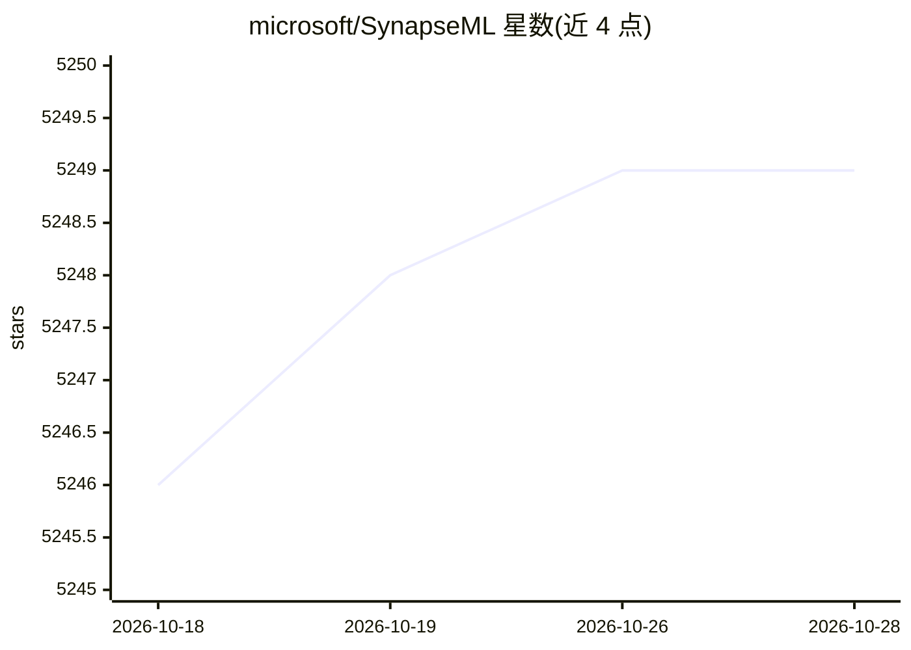

# microsoft/SynapseML

⭐ 5,250 · Scala · MIT · 推送 2026-10-28 · [GitHub](https://github.com/microsoft/SynapseML) · [官网](http://aka.ms/spark) · 组织维护

**微软开源的 Spark 分布式机器学习库，扩展 SparkML 生态**

构建于 Apache Spark 之上的开源机器学习库（前身为 MMLSpark），为文本分析、计算机视觉、异常检测、深度学习等任务提供可组合的分布式 API，与 SparkML/MLLib 共享 API，可嵌入既有 Spark 工作流。包含 LightGBM on Spark、Vowpal Wabbit、ONNX 分布式推理、Cognitive Services 大数据接入、HTTP on Spark、CyberML 等模块。支持 Python、R、Scala、Java、.NET。安装分语言包装器与 JVM 工件两部分，需按 Spark/Scala 版本选择 Maven 坐标；提供 PyPI、Maven、Docker 及 Microsoft Fabric、Databricks、EMR、Livy 等平台安装路径。

## 筛选速览

| 维度 | 判定 | 备注 |
|---|---|---|
| AI 角色 | `ai-ecosystem` | LLM/agent 周边工具 |
| 许可风险 | `permissive` | MIT |
| 部署形态 | `self-host` | docker 或自建部署 |
| 模型依赖 | — | README 未给出锁定关系 |
| 硬件要求 | — | 无带数字的原话,不猜 |
| 安装摩擦 | `low` | 无编译、无系统依赖或容器化 |
| 成熟度 | — | 结构信号不足 |

## 能力要点

- LightGBM / Vowpal Wabbit / ONNX 等算法的 Spark 分布式实现
- 将 Spark 计算以亚毫秒延迟发布为 Web 服务的 Spark Serving
- HTTP on Spark 支持分布式微服务编排
- 跨 Python/R/Scala/Java/.NET 可用，与 SparkML 共享 API

## 适用场景

- 在既有 Spark 集群上训练和评估大规模 ML 模型
- 通过 ONNX 在 Spark 中做分布式与硬件加速的模型推理
- 将 Spark 计算发布为低延迟 Web 服务
- 在 Databricks、Microsoft Fabric、EMR 等平台接入使用

## 场景标签

`模型训练` `推理引擎` · 领域:训练与推理

## 证据(README 行号)

> L5: SynapseML (previously known as MMLSpark) is an open-source library that simplifies the creation of massively scalabl
> L7: With SynapseML, you can build scalable and intelligent systems to solve challenges in domains such as anomaly detect

## 星数曲线

2026-10-18 5,246 → 2026-10-28 5,249（+3）

---
*卡片 v1 · prompt 1.4 · 生成 2026-10-20 · 置信度 high · 依据 README sha `e55d599f7884` · [字段定义](../../DATASET.md)*
