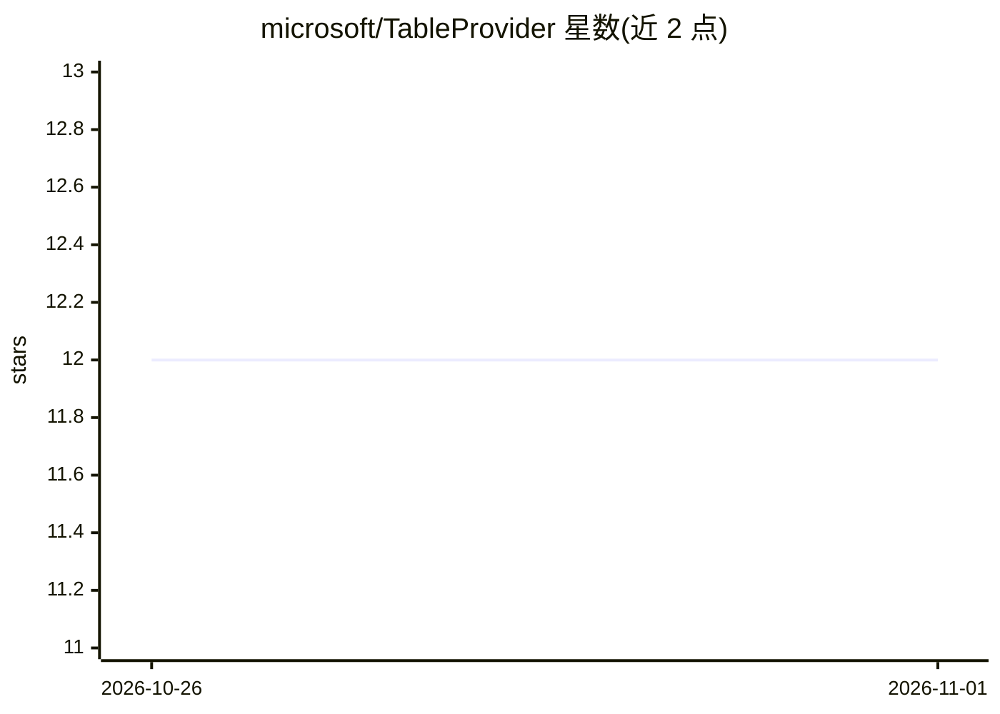

# microsoft/TableProvider

⭐ 12 · Python · MIT · 推送 2026-10-25 · [GitHub](https://github.com/microsoft/TableProvider) · [官网](https://www.microsoft.com/en-us/research/publication/table-meets-llm-can-large-language-models-understand-structured-table-data-a-benchmark-and-empirical-study/) · 组织维护

**面向 LLM 的表格数据预处理与评测工具集**

微软团队两篇论文（WSDM'24 Table Meets LLM、EMNLP'24 TAP4LLM）的代码仓库，含两个组件：TableProvider Toolkit 提供表格加载、采样、增强、格式化的完整流水线，用于把半结构化表格数据整理成适合 LLM 推理的输入（支持多种采样与增强策略，可输出 HTML/JSON/Markdown 等格式）；SUC Benchmark 用于评测 LLM 理解结构化表格数据的能力。仅支持 Python，通过 conda 环境安装；部分采样与增强选项标注为暂不可用。

## 筛选速览

| 维度 | 判定 | 备注 |
|---|---|---|
| AI 角色 | `ai-ecosystem` | LLM/agent 周边工具 |
| 许可风险 | `permissive` | MIT |
| 部署形态 | `library` | 以包/库形式分发 |
| 模型依赖 | — | README 未给出锁定关系 |
| 硬件要求 | — | 无带数字的原话,不猜 |
| 安装摩擦 | `low` | 无编译、无系统依赖或容器化 |
| 成熟度 | — | 结构信号不足 |

## 能力要点

- 表格加载→采样→增强→格式化的流水线，各组件可独立使用
- 多种采样策略（均匀/随机/聚类/顺序随机）与增强策略（表大小/列分析/摘要等）
- 输出支持 html/json/csv/tsv 等多种格式
- 含 LLM 表格理解评测基准（SUC Benchmark）

## 适用场景

- 把大表格预处理成符合 token 限制的 LLM 输入
- 为表格问答任务做采样与元数据增强
- 评测 LLM 对结构化表格数据的理解能力

## 场景标签

 · 领域:LLM 数据处理/评测

## 证据(README 行号)

> L13: 1. **TableProvider Toolkit**: A versatile pre-processor suite for leveraging LLMs in table-based tasks effectively,
> L14: 2. **SUC Benchmark**: A comprehensive benchmark for evaluating LLM capabilities with structured table data, from ou

## 星数曲线

2026-10-26 12 → 2026-11-01 12（+0）

---
*卡片 v1 · prompt 1.4 · 生成 2026-11-01 · 置信度 high · 依据 README sha `6572d65c5321` · [字段定义](../../DATASET.md)*
