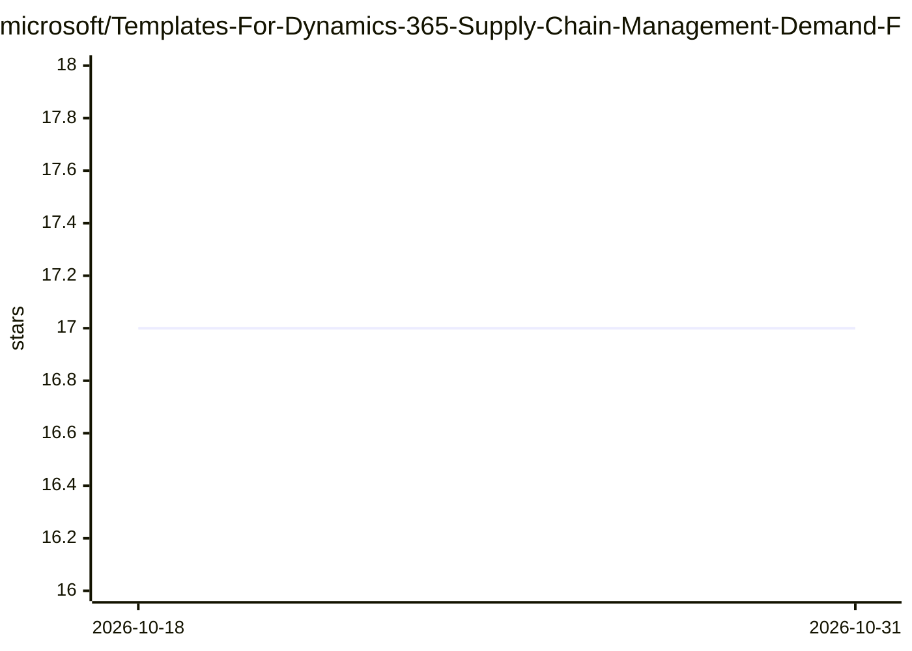

# microsoft/Templates-For-Dynamics-365-Supply-Chain-Management-Demand-Forecasting-With-Azure-Machine-Learning

⭐ 17 · Python · MIT · 推送 2026-10-30 · [GitHub](https://github.com/microsoft/Templates-For-Dynamics-365-Supply-Chain-Management-Demand-Forecasting-With-Azure-Machine-Learning) · 组织维护

**D365 SCM 需求预测对接 Azure ML 的设置模板与脚本集**

微软提供的模板仓库：用 quick_setup.ps1 在 Azure 订阅中创建或复用 Azure ML 工作区、存储、数据存储与计算资源，部署基于 SDK v2（azure-ai-ml）的预测管道，并通过一个中继 Azure Function 将 Supply Chain Management 的需求预测连接器请求翻译到 v2 管道，实现 Dynamics 365 供应链管理与 Azure 机器学习的集成。脚本完成后输出需填入需求预测参数页的配置值，并附 sampleInput.csv 用于验证。限制：依赖 Azure 订阅与 Dynamics 365 供应链管理。

## 筛选速览

| 维度 | 判定 | 备注 |
|---|---|---|
| AI 角色 | `ai-ecosystem` | LLM/agent 周边工具 |
| 许可风险 | `permissive` | MIT |
| 部署形态 | `None` |  |
| 模型依赖 | — | README 未给出锁定关系 |
| 硬件要求 | — | 无带数字的原话,不猜 |
| 安装摩擦 | `low` | 无编译、无系统依赖或容器化 |
| 成熟度 | — | 结构信号不足 |

## 能力要点

- quick_setup.ps1 幂等完成 Azure ML 工作区与中继 Function 的部署
- 中继 Azure Function 将 SCM 请求桥接到 SDK v2 管道
- 脚本从 SDK v1 迁移至 SDK v2（azure-ai-ml）

## 适用场景

- 为企业搭建 Azure ML 需求预测环境并与 D365 供应链管理集成
- 验证需求预测管道配置是否可用
- 参考 v1→v2 迁移后的管道与中继架构

## 场景标签

`数据分析` · 领域:效率与自动化

## 证据(README 行号)

> L3: This repository contains template scripts that you can use to set up your Azure environment to generate demand forec
> L14: Supply Chain Management's demand forecasting connector calls an Azure Machine Learning **v1 published-pipeline REST

## 星数曲线

2026-10-18 17 → 2026-10-31 17（+0）

---
*卡片 v1 · prompt 1.4 · 生成 2026-10-29 · 置信度 high · 依据 README sha `015625719afb` · [字段定义](../../DATASET.md)*
