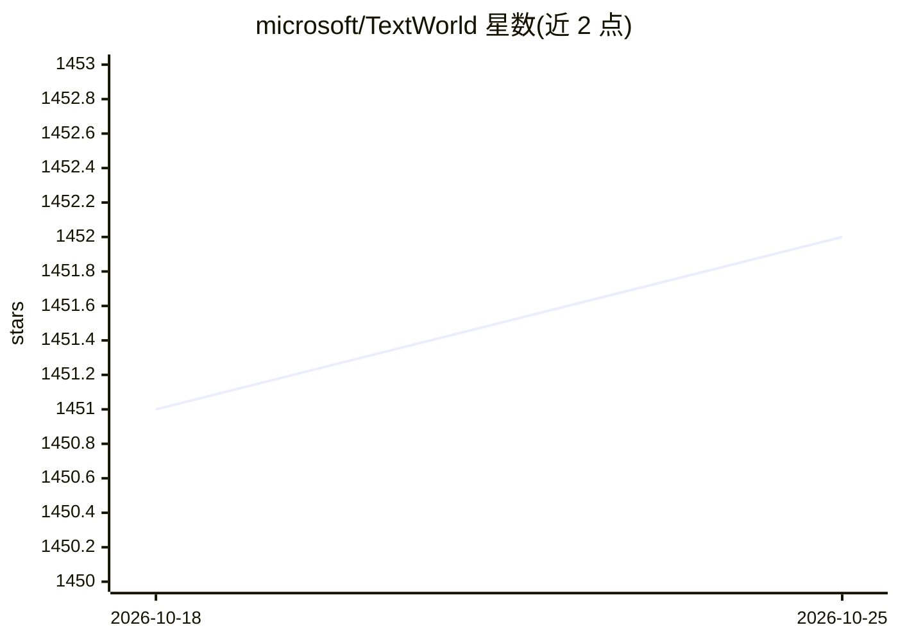

# microsoft/TextWorld

⭐ 1,452 · Jupyter Notebook · NOASSERTION · 推送 2026-10-17 · [GitHub](https://github.com/microsoft/TextWorld) · 组织维护

**文本游戏生成器与 RL 智能体训练评测沙盒环境**

微软开源的文字冒险游戏生成器与可扩展沙盒学习环境，用于训练和测试强化学习（RL）智能体。提供 tw-make 脚本按世界大小、物体数量、任务长度等参数生成文字游戏（Z-machine 格式 z1–z8），tw-play 在终端游玩，并提供 Gym 风格的 Python API 注册游戏环境。含游戏状态可视化工具（浏览器截图/图结构）。仅支持 Linux/macOS 上的 Python 3.9–3.12，Windows 需用 Docker；原生组件依赖若干系统库。MIT 许可。

## 筛选速览

| 维度 | 判定 | 备注 |
|---|---|---|
| AI 角色 | `ai-ecosystem` | LLM/agent 周边工具 |
| 许可风险 | `none` | NOASSERTION |
| 部署形态 | `self-host` | docker 或自建部署 |
| 模型依赖 | — | README 未给出锁定关系 |
| 硬件要求 | — | 无带数字的原话,不猜 |
| 安装摩擦 | `low` | 无编译、无系统依赖或容器化 |
| 成熟度 | — | 结构信号不足 |

## 能力要点

- tw-make 按世界大小/物体数/任务长度参数化生成文字游戏
- Gym 风格 Python API 与终端 tw-play 两种交互方式
- 游戏状态可视化工具（take_screenshot/visualize/show_graph）
- DockerHub 提供带 Jupyter 的容器镜像

## 适用场景

- 在生成的文字游戏上训练和评估 RL 智能体
- 用 Gym 风格 API 将文字游戏接入强化学习代码
- 通过浏览器可视化观察智能体的游戏状态

## 场景标签

`强化学习` `模型评测` · 领域:评测与运维

## 证据(README 行号)

> L9: A text-based game generator and extensible sandbox learning environment for training and testing reinforcement learn
> L88: ### Playing a game (Python + Gym-like API)

## 星数曲线

2026-10-18 1,451 → 2026-10-25 1,452（+1）

---
*卡片 v1 · prompt 1.4 · 生成 2026-10-21 · 置信度 high · 依据 README sha `9f2f63a3d196` · [字段定义](../../DATASET.md)*
