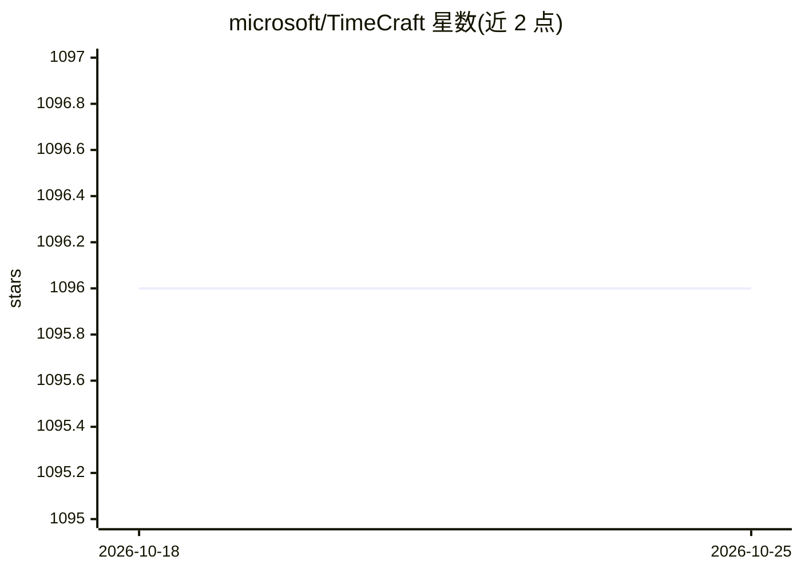

# microsoft/TimeCraft

⭐ 1,096 · Python · MIT · 推送 2026-10-19 · [GitHub](https://github.com/microsoft/TimeCraft) · 组织维护

**面向真实应用的扩散模型时间序列生成框架**

微软研究院的时间序列合成数据生成框架，基于扩散模型，提供三条可组合的输入分支：少样本目标域样例（经原型分配模块构建域提示实现跨域泛化）、自然语言文本控制（多智能体系统生成配对文本）、以及利用影响函数的下游任务感知引导。支持自动下载与预处理 Monash、GluonTS 等公开数据集，通过 conda 环境与脚本运行。仓库内含 CaTSG、OATS、Diff-MN 等子项目论文与代码，研究导向，未见打包发布或桌面构建。

## 筛选速览

| 维度 | 判定 | 备注 |
|---|---|---|
| AI 角色 | `ai-native` | 本体是模型或模型工具 |
| 许可风险 | `permissive` | MIT |
| 部署形态 | `None` |  |
| 模型依赖 | — | README 未给出锁定关系 |
| 硬件要求 | — | 无带数字的原话,不猜 |
| 安装摩擦 | `low` | 无编译、无系统依赖或容器化 |
| 成熟度 | — | 结构信号不足 |

## 能力要点

- 基于语义原型与域提示的跨域少样本泛化生成
- 自然语言文本控制趋势与季节性等特征
- 影响函数引导的目标感知生成，面向下游任务优化
- 提供公开数据集自动下载与预处理脚本

## 适用场景

- 为数据稀缺或隐私敏感场景合成时间序列数据
- 通过文本提示定制生成特定趋势/季节性的序列
- 为预测、分类、异常检测等下游任务生成增强数据

## 场景标签

 · 领域:时间序列生成/机器学习研究

## 证据(README 行号)

> L10: To address these limitations, we propose **TimeCraft**, a generic **diffusion model-based time series generation fr
> L17: 2. **Text-based control​**​: Text carries rich semantic information, domain knowledge, and instance-specific cues t
> L20: 3. **Target-aware adaptation**: TimeCraft introduces a novel approach where synthetic samples are generated with th

## 星数曲线

2026-10-18 1,096 → 2026-10-25 1,096（+0）

---
*卡片 v1 · prompt 1.4 · 生成 2026-10-21 · 置信度 high · 依据 README sha `6b690e2e4f3f` · [字段定义](../../DATASET.md)*
