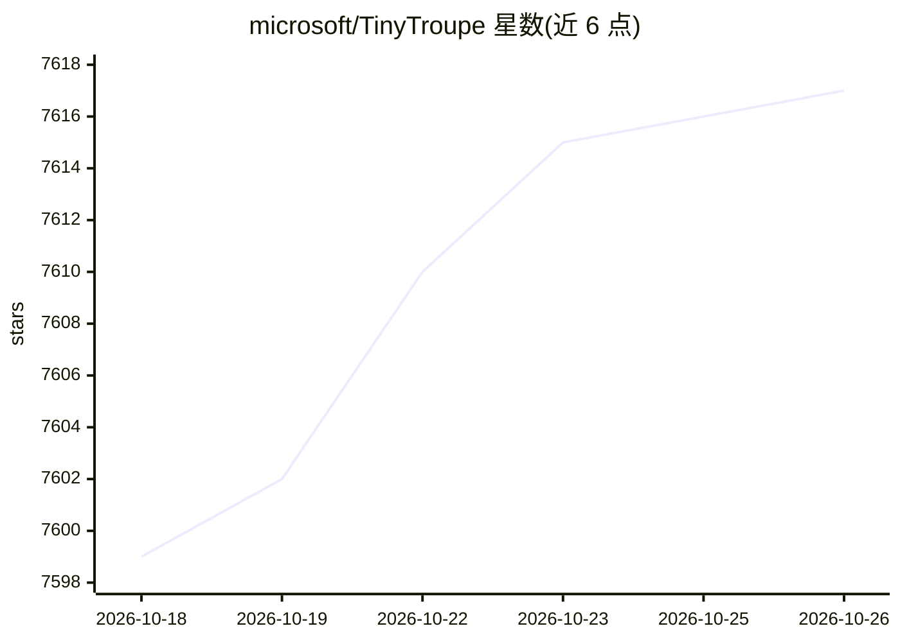

# microsoft/TinyTroupe

⭐ 7,617 · Jupyter Notebook · MIT · 推送 2026-10-23 · [GitHub](https://github.com/microsoft/TinyTroupe) · 组织维护

**微软的 LLM 多智能体人格模拟库，用于商业洞察**

实验性 Python 库，用 LLM（默认 gpt-5-mini，支持 GPT-4* 系列及实验性 Ollama 本地模型）模拟具有特定性格、兴趣与目标的虚拟人 TinyPerson，使其在 TinyWorld 环境中相互对话与行动。面向生产力与商业场景：广告离线评估、软件测试、合成数据生成、产品提案反馈与焦点小组头脑风暴，并可用 t-test/KS-test 将模拟结果与真实调查数据做实证校验。需 Python 3.10+，README 声明处于早期研究阶段、API 频繁变动，附法律免责声明（仅限研究与模拟用途）。

## 筛选速览

| 维度 | 判定 | 备注 |
|---|---|---|
| AI 角色 | `ai-native` | 本体是模型或模型工具 |
| 许可风险 | `permissive` | MIT |
| 部署形态 | `library` | 以包/库形式分发 |
| 模型依赖 | local-ok | 支持本地模型 |
| 硬件要求 | — | 无带数字的原话,不猜 |
| 安装摩擦 | `low` | 无编译、无系统依赖或容器化 |
| 成熟度 | `idea` | |

## 能力要点

- TinyPerson/TinyWorld 多智能体人格模拟，支持 JSON 定义人格与 fragments 复用
- SimulationExperimentEmpiricalValidator 用 t-test/KS-test 对照真实调查数据校验模拟
- AgentChatJupyterWidget 在 Jupyter 中与智能体交互，含 API 成本追踪
- 0.7.0 起支持视觉模态，0.6.0 起实验性支持 Ollama 本地模型

## 适用场景

- 投放前用模拟受众离线评估数字广告
- 以特定职业人格视角获取产品或项目提案反馈
- 生成合成训练数据或探索性数据
- 模拟焦点小组做产品头脑风暴并对照真实调查验证

## 场景标签

`多智能体` · 领域:Agent 开发

## 证据(README 行号)

> L13: *TinyTroupe* is an experimental Python library that allows the **simulation** of people with specific personalities
> L15:  - **Advertisement:** TinyTroupe can **evaluate digital ads (e.g., Bing Ads)** offline with a simulated audience be
> L45:  - Introduces `SimulationExperimentEmpiricalValidator` to compare simulation results against real-world empirical d

## 星数曲线

2026-10-18 7,599 → 2026-10-26 7,617（+18）

---
*卡片 v1 · prompt 1.4 · 生成 2026-10-20 · 置信度 high · 依据 README sha `4e14da32f352` · [字段定义](../../DATASET.md)*
