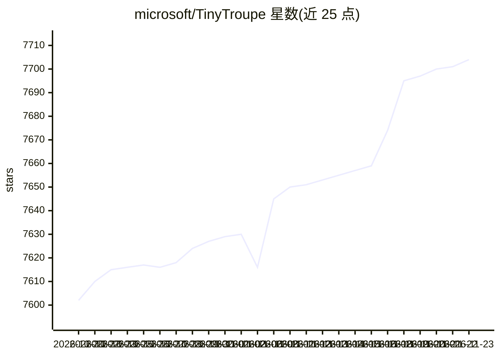

# microsoft/TinyTroupe

⭐ 7,704 · Jupyter Notebook · MIT · 推送 2026-11-06 · [GitHub](https://github.com/microsoft/TinyTroupe) · 组织维护

**LLM 驱动的人格化多智能体仿真库，用于商业洞察**

实验性 Python 库，通过 GPT-4 等大模型模拟具有特定人格、兴趣与目标的虚拟人物（TinyPerson），在 TinyWorld 环境中交互以模拟用户访谈、广告评估、焦点小组、合成数据生成等场景。0.6.0 引入统计检验（t-test/KS-test）将仿真结果与真实调研数据对比验证，0.7.0 加入视觉模态。README 明确声明处于早期研究阶段，API 频繁变更，仅限研究与仿真用途并附法律免责声明。

## 筛选速览

| 维度 | 判定 | 备注 |
|---|---|---|
| AI 角色 | `ai-native` | 本体是模型或模型工具 |
| 许可风险 | `permissive` | MIT |
| 部署形态 | `library` | 以包/库形式分发 |
| 模型依赖 | local-ok | 支持本地模型 |
| 硬件要求 | — | 无带数字的原话,不猜 |
| 安装摩擦 | `low` | 无编译、无系统依赖或容器化 |
| 成熟度 | `idea` | |

## 能力要点

- 可定制人格的 TinyPerson 智能体，支持 JSON 文件定义与 fragments 复用
- 仿真结果可用统计检验（t-test/KS-test）对照真实数据验证
- 支持 Jupyter notebook 交互式对话组件与 API 成本追踪
- 0.7.0 起支持视觉模态输入

## 适用场景

- 投放前用模拟受众离线评估数字广告效果
- 生成合成数据用于模型训练或机会分析
- 以特定人格视角（医生、律师等）获取产品提案反馈
- 模拟焦点小组做低成本头脑风暴

## 场景标签

`多智能体` · 领域:Agent 开发

## 证据(README 行号)

> L13: *TinyTroupe* is an experimental Python library that allows the **simulation** of people with specific personalities
> L48:  - Adds experimental/limited Ollama support for local models. See Ollama Support for details.

## 星数曲线

2026-10-20 7,602 → 2026-11-23 7,704（+102）

---
*卡片 v1 · prompt 1.4 · 生成 2026-11-22 · 置信度 high · 依据 README sha `ca3e21dce1e9` · [字段定义](../../DATASET.md)*
