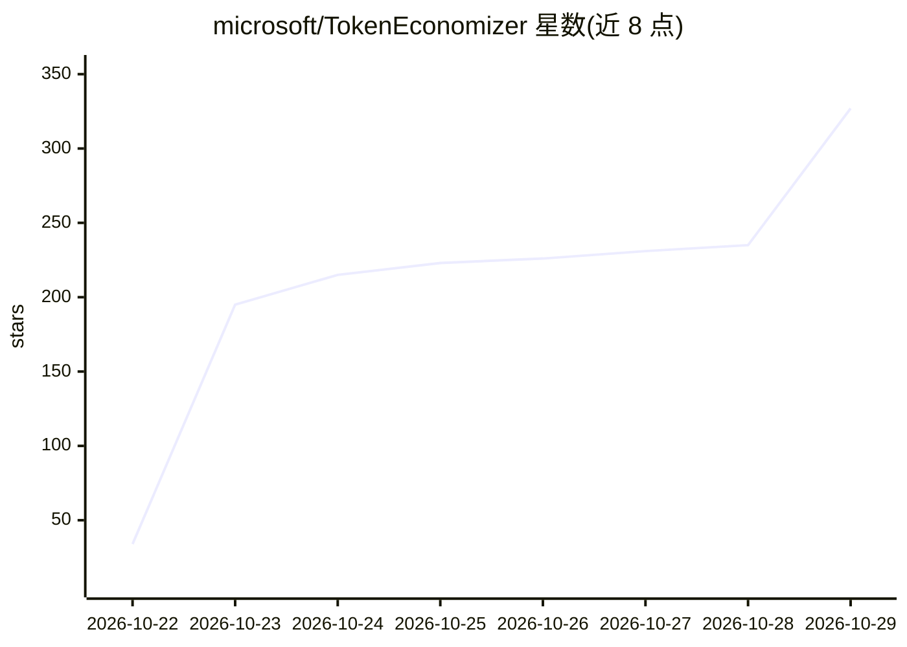

# microsoft/TokenEconomizer

⭐ 327 · Python · Apache-2.0 · 推送 2026-10-26 · [GitHub](https://github.com/microsoft/TokenEconomizer) · 组织维护

**编码 agent 的成本控制插件：从历史会话学习并削减后续开销**

面向 Claude Code、Codex、GitHub Copilot CLI 与 Pi 的插件，不改动 agent 本身的模型与代码，而是读取仓库内已完成的会话，调整后续会话的开销：从重复失败中学习环境事实（micro-skills）注入下次会话开头、将连续多次未使用的工具通过 agent 自身设置移出（toolprune）、对重复失败的 edit-and-test 循环做一次重定向（loopguard）。默认自身不调用模型，学习内容保存在 ~/.tokeneconomizer；三种机制均可独立关闭。论文报告 SWE-Bench 上五种 agent–模型组合平均成本降低 18.4–30.9%。

## 筛选速览

| 维度 | 判定 | 备注 |
|---|---|---|
| AI 角色 | `ai-ecosystem` | LLM/agent 周边工具 |
| 许可风险 | `permissive` | Apache-2.0 |
| 部署形态 | `None` |  |
| 模型依赖 | — | README 未给出锁定关系 |
| 硬件要求 | — | 无带数字的原话,不猜 |
| 安装摩擦 | `low` | 无编译、无系统依赖或容器化 |
| 成熟度 | — | 结构信号不足 |

## 能力要点

- micro-skills 从反复失败证据中学习环境事实，无需模型调用
- toolprune 将连续未使用的工具经 agent 自身设置移出，可一键恢复
- loopguard 对卡住的回合做一次重定向，从不自行停止回合
- 三种机制可独立开关，默认不发起任何模型调用

## 适用场景

- 在长期维护的仓库上降低编码 agent 的每任务 token 成本
- 让 agent 不必每次会话重复踩坑发现环境事实
- 减少无用工具加载和陷入失败循环的浪费

## 场景标签

 · 领域:LLM 基础设施/编码 agent 工具

## 证据(README 行号)

> L29: TokenEconomizer is a plugin for **Claude Code**, **Codex**, the **GitHub Copilot CLI** and
> L30: **Pi**. It leaves the agent as it is, reads each finished session in a repository, and changes
> L91: Run the shell commands where the clone should stay: Claude Code, Codex and the Copilot CLI run

## 星数曲线

2026-10-22 34 → 2026-10-29 327（+293）

---
*卡片 v1 · prompt 1.4 · 生成 2026-10-23 · 置信度 high · 依据 README sha `ed7a013c0697` · [字段定义](../../DATASET.md)*
