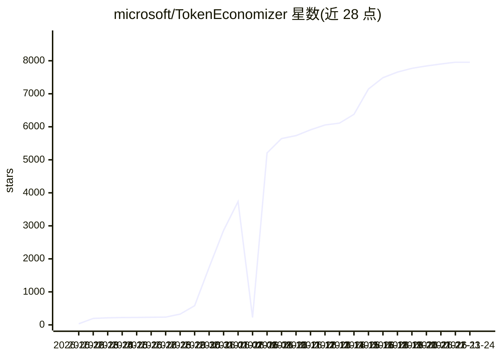

# microsoft/TokenEconomizer

⭐ 7,955 · Python · MIT · 推送 2026-11-20 · [GitHub](https://github.com/microsoft/TokenEconomizer) · 组织维护

**为编程 agent 降低会话成本的插件：跨会话学习剪除浪费**

以插件形式为 Claude Code、Codex、GitHub Copilot CLI、Pi 等 agent 提供黑盒成本控制：从同一仓库的历史会话中学习，通过三个机制削减重复开销——micro-skills 记录仓库运行事实并在会话开始注入、tool pruning 按使用统计停用未用工具、loop guard 由 judge 模型检测卡死循环并注入改道提示。不改 agent 本体，学习数据存于本地，插件自身模型调用走用户已有登录。支持多项可开关设置与逐项动作报告。

## 筛选速览

| 维度 | 判定 | 备注 |
|---|---|---|
| AI 角色 | `ai-ecosystem` | LLM/agent 周边工具 |
| 许可风险 | `permissive` | MIT |
| 部署形态 | `library` | 以包/库形式分发 |
| 模型依赖 | — | README 未给出锁定关系 |
| 硬件要求 | — | 无带数字的原话,不猜 |
| 安装摩擦 | `low` | 无编译、无系统依赖或容器化 |
| 成熟度 | `idea` | |

## 能力要点

- micro-skills 跨会话记忆仓库事实（构建命令、环境变量等），三次会话确认后生效，被反驳即丢弃
- tool pruning 按跨会话使用统计经 agent 自身设置停用未用工具，可一键恢复
- loop guard 检测同错误循环并注入改道提示，不代用户终止回合
- 成本按缓存定价计算，含插件自身调用；支持 Claude Code/Codex/Copilot CLI/Pi 等 4 个正式宿主与 6 个实验宿主

## 适用场景

- 在同一仓库反复使用编程 agent 时降低会话开销
- 避免 agent 每次会话重新摸索仓库的构建与测试命令
- 发现并干预 agent 反复陷入同一报错的循环

## 场景标签

`编码 Agent` `Agent 记忆` · 领域:Agent 开发

## 证据(README 行号)

> L57: TokenEconomizer is a plugin for **Claude Code**, **Codex**, the **GitHub Copilot CLI** and **Pi**,
> L33: TokenEconomizer makes coding agents cheaper to run in the repositories you work in often,
> L102: You need one of these agents, signed in any way it supports, and Python 3.10 or newer on

## 星数曲线

2026-10-22 34 → 2026-11-24 7,955（+7,921）

---
*卡片 v1 · prompt 1.4 · 生成 2026-11-22 · 置信度 mid · 依据 README sha `b4fad007f2b2` · [字段定义](../../DATASET.md)*
