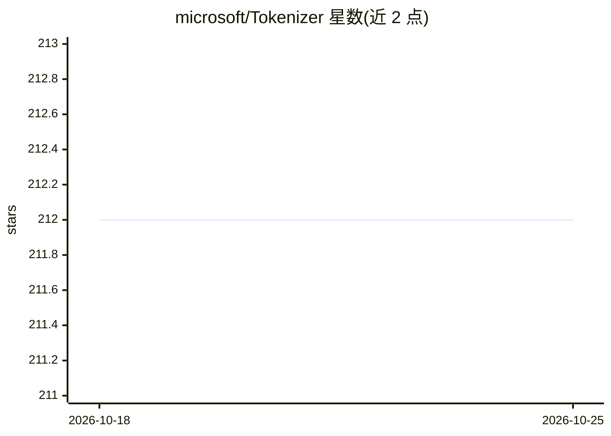

# microsoft/Tokenizer

⭐ 212 · C# · MIT · 推送 2026-10-19 · [GitHub](https://github.com/microsoft/Tokenizer) · [官网](https://github.com/microsoft/Tokenizer/) · 组织维护

**面向 OpenAI LLM 的 BPE 分词器 TypeScript/.NET 实现**

微软仓库，提供 BPE 分词算法的 TypeScript 与 C# 双实现，基于 OpenAI tiktoken 的 Rust 实现移植，用于在 Node.js 与 .NET 环境中在送入 LLM 前对 prompt 做分词。仓库含两个子实现，各自有独立 README。C# 实现已标记迁移：Microsoft.DeepDev.TokenizerLib 用户被引导迁移至 .NET 团队维护的 Microsoft.ML.Tokenizers（随 .NET 9 稳定发布），可视为该 C# 库处于被取代状态。

## 筛选速览

| 维度 | 判定 | 备注 |
|---|---|---|
| AI 角色 | `ai-ecosystem` | LLM/agent 周边工具 |
| 许可风险 | `permissive` | MIT |
| 部署形态 | `None` |  |
| 模型依赖 | — | README 未给出锁定关系 |
| 硬件要求 | — | 无带数字的原话,不猜 |
| 安装摩擦 | `medium` | 含编译或系统依赖之一 |
| 成熟度 | — | 结构信号不足 |

## 能力要点

- TypeScript 与 C# 双实现的 BPE 分词器
- 基于 OpenAI tiktoken 的 Rust 开源实现移植
- 供 Node.js 与 .NET 环境对 prompt 做分词

## 适用场景

- 在 Node.js/.NET 应用中本地计算 prompt 的 token 数
- 构建 LLM 调用前的分词预处理逻辑

## 场景标签

 · 领域:LLM 基础设施/文本处理

## 证据(README 行号)

> L3: This repo contains Typescript and C# implementation of byte pair encoding(BPE) tokenizer for OpenAI LLMs, it's based
> L12:  > Users of `Microsoft.DeepDev.TokenizerLib` should migrate to `Microsoft.ML.Tokenizers`. The functionality in `Mic

## 星数曲线

2026-10-18 212 → 2026-10-25 212（+0）

---
*卡片 v1 · prompt 1.4 · 生成 2026-10-22 · 置信度 high · 依据 README sha `b6f0dc68e1ec` · [字段定义](../../DATASET.md)*
