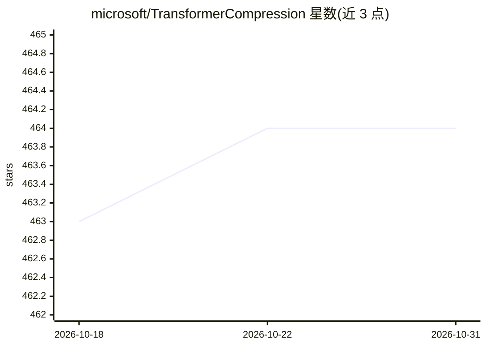

# microsoft/TransformerCompression

⭐ 464 · Python · MIT · 推送 2026-09-10 · [GitHub](https://github.com/microsoft/TransformerCompression) · 组织维护

**SliceGPT 官方代码库：通过正交变换剪切压缩 Transformer/LLM**

微软发布的 ICLR'24 论文 SliceGPT 配套代码，实现一种后训练稀疏化方案：对每个 transformer 层施加保持模型不变的正交变换，再按特征值衰减选出最不重要的行/列从权重矩阵中切除，用更小的稠密矩阵替换原矩阵以降低嵌入维度，从而获得加速与内存占用降低。以 Python 包 slicegpt 提供压缩脚本、切片后恢复微调（RFT/LoRA）脚本与 LM Eval Harness 评测脚本，列出 16 个支持的 Hugging Face 模型，并可通过实现 ModelAdapter/LayerAdapter 接口扩展新模型。

## 筛选速览

| 维度 | 判定 | 备注 |
|---|---|---|
| AI 角色 | `ai-ecosystem` | LLM/agent 周边工具 |
| 许可风险 | `permissive` | MIT |
| 部署形态 | `library` | 以包/库形式分发 |
| 模型依赖 | — | README 未给出锁定关系 |
| 硬件要求 | — | 无带数字的原话,不猜 |
| 安装摩擦 | `low` | 无编译、无系统依赖或容器化 |
| 成熟度 | — | 结构信号不足 |

## 能力要点

- 正交变换+剪切的后训练压缩，模型结构不变、权重矩阵变小
- 提供压缩、恢复微调（LoRA/RFT）、lm-eval 评测三套脚本
- 支持 phi-2/Phi-3、Llama-2/3、OPT 系列 16 个模型
- 通过 ModelAdapter/LayerAdapter 接口扩展新模型支持

## 适用场景

- 压缩 LLM 以降低内存占用并加速推理
- 复现 SliceGPT 论文实验与评测结果
- 对切片后模型做恢复微调以找回精度

## 场景标签

`模型量化` · 领域:训练与推理

## 证据(README 行号)

> L3: This repository contains the code for the paper SliceGPT (ICLR'24). Also discussed on Hugging Face.
> L11: The code is arranged as a package `slicegpt` in `/src`, and scripts to replicate experiments from the paper are in

## 星数曲线

2026-10-18 463 → 2026-10-31 464（+1）

---
*卡片 v1 · prompt 1.4 · 生成 2026-10-21 · 置信度 high · 依据 README sha `0c7b2f272481` · [字段定义](../../DATASET.md)*
