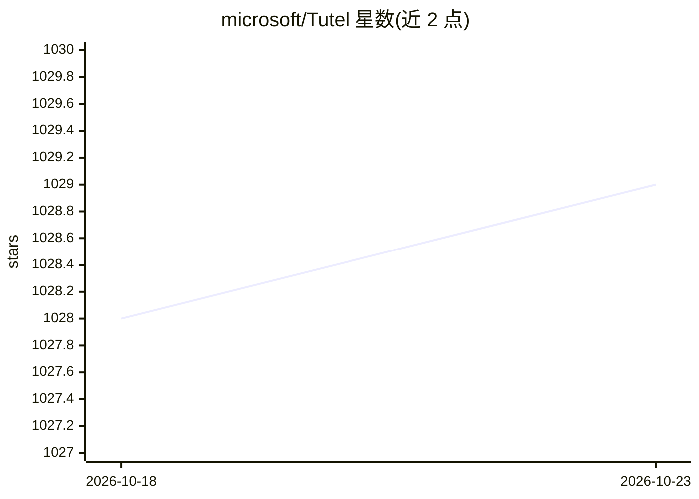

# microsoft/Tutel

⭐ 1,029 · C · MIT · 推送 2026-10-21 · [GitHub](https://github.com/microsoft/Tutel) · 组织维护

**微软的 MoE 优化推理库：低精度运行 DeepSeek/Kimi/GLM 等大模型**

微软维护的 Mixture-of-Experts 优化实现库，面向现代训练与推理中动态行为的并行/稀疏/容量切换，支持对 GLM-5.x、DeepSeek-3.x、Kimi-K2/K3、Qwen3、GPT-OSS 等 MoE 模型的 NVFP4/MXFP4/BlockwiseFP8 直接推理，运行于 A100/A800/H100/B200/MI300 等 GPU，并通过 Docker 镜像提供服务端（serve=core/webui）。附带与 vLLM/SGL 的吞吐对比表、Claude Code 接入示例、OpenAI/Ollama 风格请求接口及 VibeVoice 多模态语音生成支持。以 Docker 与 pip 安装为主，需多卡 GPU 环境。

## 筛选速览

| 维度 | 判定 | 备注 |
|---|---|---|
| AI 角色 | `ai-ecosystem` | LLM/agent 周边工具 |
| 许可风险 | `permissive` | MIT |
| 部署形态 | `self-host` | docker 或自建部署 |
| 模型依赖 | locked-api |  |
| 硬件要求 | — | 无带数字的原话,不猜 |
| 安装摩擦 | `low` | 无编译、无系统依赖或容器化 |
| 成熟度 | — | 结构信号不足 |

## 能力要点

- NVFP4/MXFP4/BlockwiseFP8 低精度 MoE 推理
- 支持 DeepSeek V3.2、Kimi K2/K3、GLM-5.x、Qwen3、GPT-OSS 等模型
- NVIDIA（A100/H100/B200）与 AMD（MI300/MI325）GPU 均可运行
- 提供 1M 长上下文服务与 Claude Code、Open-WebUI、OpenAI/Ollama 风格接口

## 适用场景

- 在多卡 GPU 服务器上以低精度部署 DeepSeek/Kimi 等大型 MoE 模型
- 在显存受限的 A100/MI300 上跑 1M 长上下文推理
- 通过 Claude Code 或 OpenAI 兼容接口调用自托管 MoE 模型

## 场景标签

`推理引擎` `模型量化` · 领域:训练与推理

## 证据(README 行号)

> L3: Tutel MoE: An Optimized Mixture-of-Experts Implementation, also the first parallel solution proposing "No-penalty Pa
> L44: > docker run -e WORKER=1 -e LOCAL_SIZE=8 -p 8000:8000 -it --rm --ipc=host --shm-size=8g \

## 星数曲线

2026-10-18 1,028 → 2026-10-23 1,029（+1）

---
*卡片 v1 · prompt 1.4 · 生成 2026-10-21 · 置信度 mid · 依据 README sha `c07dffa4c11c` · [字段定义](../../DATASET.md)*
