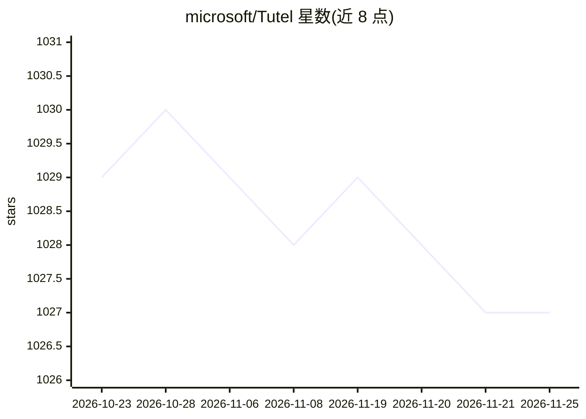

# microsoft/Tutel

⭐ 1,027 · C · MIT · 推送 2026-11-06 · [GitHub](https://github.com/microsoft/Tutel) · 组织维护

**面向科研与工程的 MoE 优化推理/训练库：大模型高效并行**

微软开源的 Mixture-of-Experts 优化实现库，提出动态并行/稀疏/容量切换的并行方案，支持 GLM、DeepSeek、Kimi、Qwen3、Gpt-OSS 等 MoE 模型的 NVFP4/MXFP4/BlockwiseFP8 推理。README 主要以 Docker 镜像形式提供部署流程：从 Hugging Face 下载模型权重，通过 docker run 在 A100/H100/MI300 等多卡环境启动服务，开放 OpenAI 兼容接口与 WebUI，并可接入 Claude Code 作为 Agent 后端。还提供语音生成（VibeVoice）示例与吞吐量测试数据。

## 筛选速览

| 维度 | 判定 | 备注 |
|---|---|---|
| AI 角色 | `ai-ecosystem` | LLM/agent 周边工具 |
| 许可风险 | `permissive` | MIT |
| 部署形态 | `self-host` | docker 或自建部署 |
| 模型依赖 | — | README 未给出锁定关系 |
| 硬件要求 | — | 无带数字的原话,不猜 |
| 安装摩擦 | `low` | 无编译、无系统依赖或容器化 |
| 成熟度 | — | 结构信号不足 |

## 能力要点

- 支持 GLM/DeepSeek/Kimi/Qwen3/Gpt-OSS 等 MoE 模型的 NVFP4/MXFP4/FP8 推理
- 提供 Azure MI300/A100/H100 多卡环境的 Docker 一键部署镜像
- 开放 OpenAI 兼容接口、WebUI，可接入 Claude Code 作为 Agent 后端
- 支持 1M 长上下文与视觉输入（部分模型）

## 适用场景

- 在多卡 GPU 服务器上部署 671B 级 MoE 大模型推理服务
- 为 Claude Code 等 Agent 工具搭建本地模型后端
- 本地生成多说话人对话音频（VibeVoice 示例）

## 场景标签

`推理引擎` · 领域:训练与推理

## 证据(README 行号)

> L3: Tutel MoE: An Optimized Mixture-of-Experts Implementation, also the first parallel solution proposing "No-penalty Pa
> L64: > [ND_A100_80G_v4: Serve GLM-5/5.1/5.2/5.3 (for Azure A100x8/H100x8/B200x8/RTX-6000PRO SXM)]
> L158: > [OpenAI/Ollama/Direct Request]

## 星数曲线

2026-10-23 1,029 → 2026-11-25 1,027（-2）

---
*卡片 v1 · prompt 1.4 · 生成 2026-11-24 · 置信度 mid · 依据 README sha `f0cc065681b7` · [字段定义](../../DATASET.md)*
