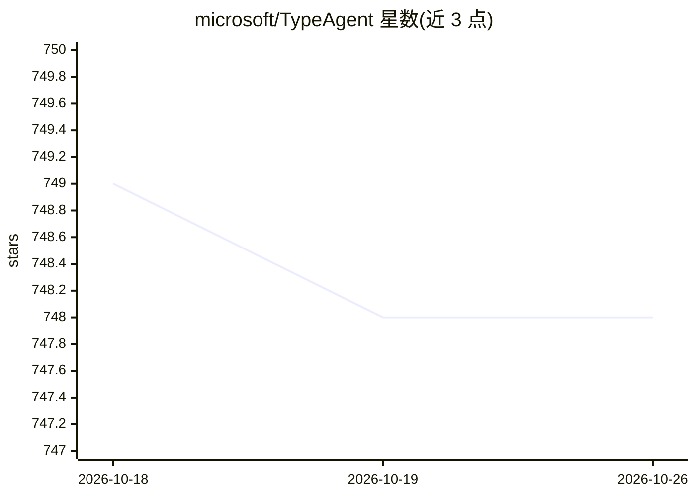

# microsoft/TypeAgent

⭐ 748 · TypeScript · MIT · 推送 2026-10-25 · [GitHub](https://github.com/microsoft/TypeAgent) · 组织维护

**微软的示例代码：用 LLM 构建统一自然语言个人 agent 架构**

微软开源的示例代码（sample code），探索以 LLM 与结构化提示构建单一个人 agent：通过 Dispatcher 将用户请求路由到注册的应用 agent，覆盖音乐、邮件、日历、浏览器等示例应用；以 Structured RAG 实现对话记忆，TypeAgent Cache 缓存动作翻译以降低成本与延迟。提供 TypeAgent Shell（Electron）与 CLI 入口，monorepo 含 TypeScript/Python/.NET/Android 代码。明确声明为早期阶段示例、非框架，仅在开发者本机以 Azure OpenAI 服务测试、英文测试，需用户自备 API key。

## 筛选速览

| 维度 | 判定 | 备注 |
|---|---|---|
| AI 角色 | `ai-native` | 本体是模型或模型工具 |
| 许可风险 | `permissive` | MIT |
| 部署形态 | `None` |  |
| 模型依赖 | — | README 未给出锁定关系 |
| 硬件要求 | — | 无带数字的原话,不猜 |
| 安装摩擦 | `medium` | 含编译或系统依赖之一 |
| 成熟度 | `idea` | |

## 能力要点

- Dispatcher 按类型化契约将用户请求路由到应用 agent
- 基于 Structured RAG 的对话记忆（KnowPro）
- TypeAgent Cache 缓存动作翻译以减少 LLM 调用
- 15 个示例应用 agent 与 Shell/CLI 入口，支持自定义插件 agent

## 适用场景

- 研究者探索自然语言 agent 架构与结构化提示技术
- 开发者参照示例编写接入 Dispatcher 的自定义插件 agent
- 在本地跑通 TypeAgent Shell 体验多 agent 协同的个人助手

## 场景标签

`AI 助手` `多智能体` · 领域:Agent 开发

## 证据(README 行号)

> L5: **TypeAgent** is **sample code** that explores an architecture for building a _single personal agent_ with _natural 
> L34: TypeAgent Shell example is the starting point to explore the **single personal agent** with **natural language inte
> L74: - TypeAgent is sample code shared to encourage the exploration of natural language agent architectures using struct

## 星数曲线

2026-10-18 749 → 2026-10-26 748（-1）

---
*卡片 v1 · prompt 1.4 · 生成 2026-10-21 · 置信度 high · 依据 README sha `68c31631c6dd` · [字段定义](../../DATASET.md)*
