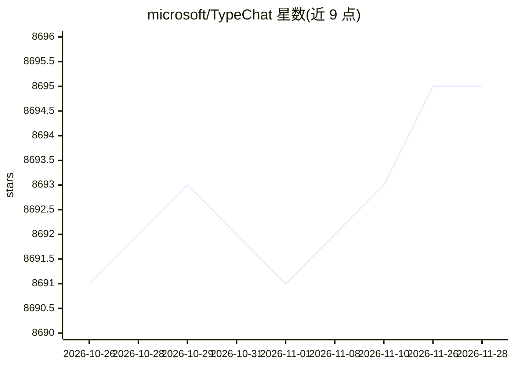

# microsoft/TypeChat

⭐ 8,695 · JavaScript · MIT · 推送 2026-11-26 · [GitHub](https://github.com/microsoft/TypeChat) · [官网](https://microsoft.github.io/TypeChat/) · 组织维护 · 中文 README

**用类型定义构建自然语言界面的 TypeScript 库**

TypeChat 是一个让开发者用类型（schema）构建自然语言界面的库：开发者定义表示应用支持的意图的类型，库负责构造发给 LLM 的提示、校验模型响应是否符合 schema、失败时通过后续模型交互修复输出，并用非 LLM 方式对实例做简短摘要确认用户意图。README 称这种方式以 schema engineering 替代 prompt engineering。提供 npm 包安装，另有 Python、TypeScript、C#/.NET 的源码使用方式，并附示例项目与文档。仓库另记录一项半自动化维护流程实验与 GOALS.md 的项目范围政策。

## 筛选速览

| 维度 | 判定 | 备注 |
|---|---|---|
| AI 角色 | `ai-ecosystem` | LLM/agent 周边工具 |
| 许可风险 | `permissive` | MIT |
| 部署形态 | `library` | 以包/库形式分发 |
| 模型依赖 | — | README 未给出锁定关系 |
| 硬件要求 | — | 无带数字的原话,不猜 |
| 安装摩擦 | `low` | 无编译、无系统依赖或容器化 |
| 成熟度 | — | 结构信号不足 |

## 能力要点

- 用类型定义意图，库自动构造提示并校验/修复 LLM 响应
- 支持 TypeScript/JavaScript npm 包及 Python、C#/.NET 源码方式
- 提供示例项目与 GitHub Codespace 体验途径
- README 记录半自动化仓库维护实验与人审政策

## 适用场景

- 为应用添加自然语言输入并映射到结构化意图
- 将用户对话转换为购物车、音乐应用等类型的结构化操作
- 约束并校验 LLM 输出使其符合应用 schema

## 场景标签

 · 领域:LLM 应用开发框架

## 证据(README 行号)

> L5: TypeChat is a library that makes it easy to build natural language interfaces using types.
> L13: After defining your types, TypeChat takes care of the rest by:
> L16: 2. Validating the LLM response conforms to the schema. If the validation fails, repair the non-conforming output th

## 星数曲线

2026-10-26 8,691 → 2026-11-28 8,695（+4）

---
*卡片 v1 · prompt 1.4 · 生成 2026-11-22 · 置信度 high · 依据 README sha `33d75d533cf5` · [字段定义](../../DATASET.md)*
