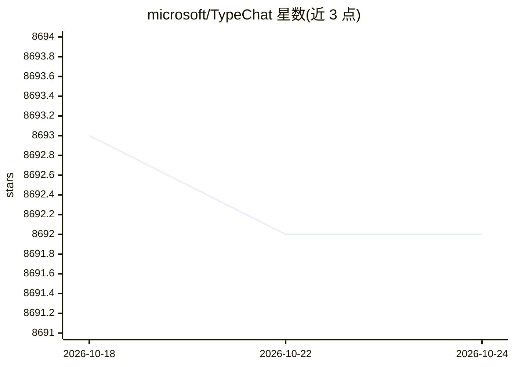

# microsoft/TypeChat

⭐ 8,691 · TypeScript · MIT · 推送 2026-10-24 · [GitHub](https://github.com/microsoft/TypeChat) · [官网](https://microsoft.github.io/TypeChat/) · 组织维护

**用类型 schema 构建自然语言接口的库**

TypeChat 是微软维护的库，把自然语言请求映射到开发者定义的类型 schema 上，以 schema 工程替代 prompt 工程。机制：用类型构造提示词发给 LLM、校验响应是否符合 schema、校验失败时通过与模型继续交互修复不合规输出，并在不用 LLM 的情况下摘要确认结果与用户意图一致。支持 TypeScript/JavaScript（npm 安装），并可从源码使用 Python、C#/.NET 版本。

## 筛选速览

| 维度 | 判定 | 备注 |
|---|---|---|
| AI 角色 | `ai-ecosystem` | LLM/agent 周边工具 |
| 许可风险 | `permissive` | MIT |
| 部署形态 | `library` | 以包/库形式分发 |
| 模型依赖 | — | README 未给出锁定关系 |
| 硬件要求 | — | 无带数字的原话,不猜 |
| 安装摩擦 | `low` | 无编译、无系统依赖或容器化 |
| 成熟度 | — | 结构信号不足 |

## 能力要点

- 以 schema 工程替代 prompt 工程，意图即类型定义
- 校验 LLM 输出是否符合 schema，失败时自动修复
- 不使用 LLM 的实例摘要与意图确认

## 适用场景

- 为应用添加意图分类、情感分类等自然语言接口
- 把用户自然语言输入结构化为购物车、音乐播放等可处理数据
- 约束 LLM 回复格式以便后续程序处理

## 场景标签

`提示工程` · 领域:Agent 开发

## 证据(README 行号)

> L3: TypeChat is a library that makes it easy to build natural language interfaces using types.
> L13: 1. Constructing a prompt to the LLM using types.
> L14: 2. Validating the LLM response conforms to the schema. If the validation fails, repair the non-conforming output th

## 星数曲线

2026-10-18 8,693 → 2026-10-24 8,692（-1）

---
*卡片 v1 · prompt 1.4 · 生成 2026-10-20 · 置信度 high · 依据 README sha `399a0ecbf351` · [字段定义](../../DATASET.md)*
