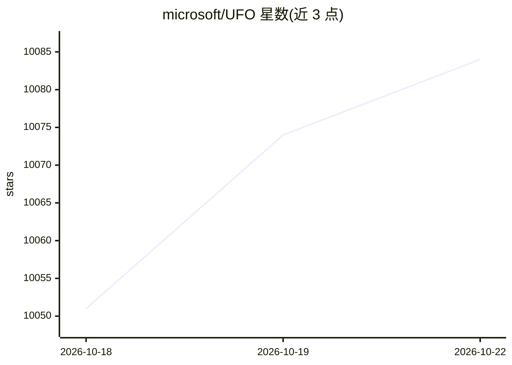

# microsoft/UFO

⭐ 10,056 · Python · MIT · 推送 2026-10-19 · [GitHub](https://github.com/microsoft/UFO) · [官网](https://microsoft.github.io/UFO/) · 组织维护 · 中文 README

**微软的 Windows GUI Agent 与多设备 Agent 编排框架**

包含两部分：UFO² 是面向单机 Windows 自动化的桌面 AgentOS，通过 Windows UIA/Win32/WinCOM 原生控件集成与 GUI+API 混合动作执行任务，支持多动作批量预测以减少 LLM 调用，并提供 RAG 知识底座；UFO³ Galaxy 是多设备编排框架，将用户请求分解为可动态编辑的 DAG，经基于能力的设备匹配在 Windows/Linux/Android 异构设备上并行异步执行，通过 WebSocket 的 AIP 协议协调。需配置 OpenAI 或 Azure OpenAI 等 LLM API，以 pip 安装依赖并从源码运行，附 arXiv 论文。

## 筛选速览

| 维度 | 判定 | 备注 |
|---|---|---|
| AI 角色 | `ai-ecosystem` | LLM/agent 周边工具 |
| 许可风险 | `permissive` | MIT |
| 部署形态 | `library` | 以包/库形式分发 |
| 模型依赖 | locked-api |  |
| 硬件要求 | — | 无带数字的原话,不猜 |
| 安装摩擦 | `low` | 无编译、无系统依赖或容器化 |
| 成熟度 | `idea` | |

## 能力要点

- UFO² 深度集成 Windows UIA/Win32/WinCOM，GUI+API 混合动作
- UFO³ Galaxy 将请求分解为 DAG 并支持动态编辑与异步并行执行
- AIP WebSocket 协议实现跨设备 Agent 安全通信与容错重连
- MCP 集成的模板驱动设备 Agent 开发工具包

## 适用场景

- 在 Windows 上用自然语言驱动 GUI 完成自动化任务
- 编排跨 Windows/Linux/Android 多设备的复杂工作流
- 将 UFO² 作为 Galaxy 编排中的 Windows 设备执行器

## 场景标签

`GUI 自动化` `工作流自动化` `Agent 框架` · 领域:Agent 开发

## 证据(README 行号)

> L35: - **Constellation**: Task decomposition into executable DAGs
> L53: - Deep Windows OS integration
> L93: 5. **🛠️ Template-Driven MCP-Empowered Device Agents** - Lightweight toolkit for rapid agent development with MCP in

## 星数曲线

2026-10-18 10,051 → 2026-10-22 10,084（+33）

---
*卡片 v1 · prompt 1.4 · 生成 2026-10-20 · 置信度 high · 依据 README sha `1e07a7049396` · [字段定义](../../DATASET.md)*
