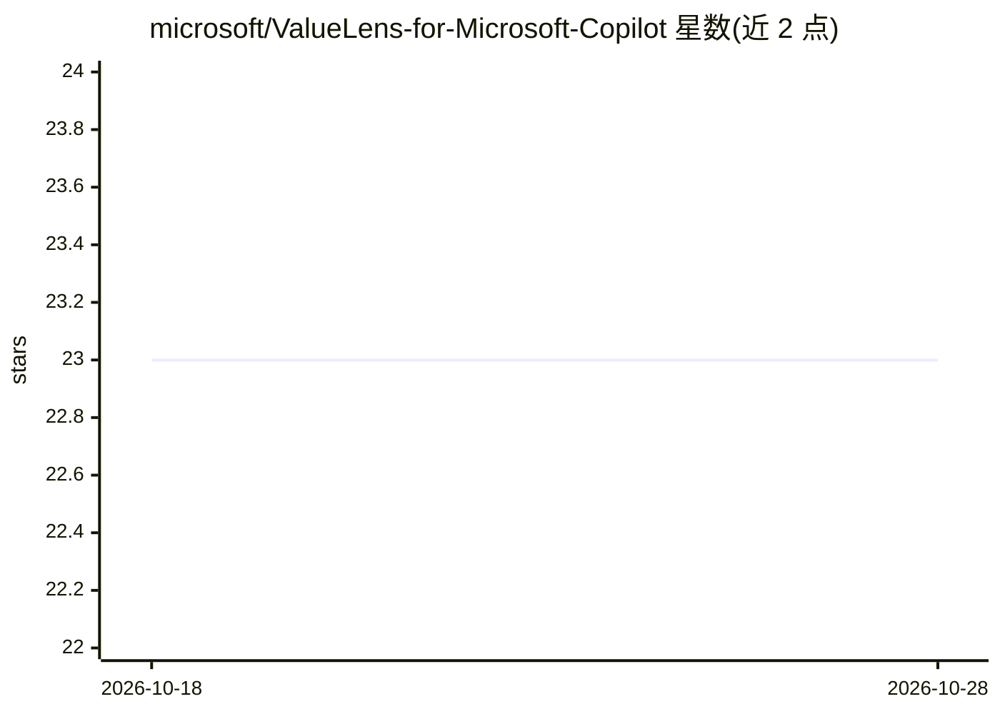

# microsoft/ValueLens-for-Microsoft-Copilot

⭐ 23 · TypeScript · MIT · 推送 2026-10-27 · [GitHub](https://github.com/microsoft/ValueLens-for-Microsoft-Copilot) · 组织维护

**度量 Microsoft 365 Copilot 与 agent 使用价值的 Power BI 模板**

由 Microsoft 维护的 Power BI 模板与 Power Apps 应用：读取 Purview 审计日志等数据，展示组织内 Microsoft 365 Copilot 与 agent 的采用、使用习惯、交付工时与价值、治理与用户反馈，覆盖 Adoption/Habits/Agents/Value 等 15 页报表。提供安装器（Fabric/Azure）与手动路径（Fabric/SharePoint/本地 CSV），需 Power BI Pro、Fabric F2+ 等许可与全局管理员批准只读 Graph 访问。自声明为实验性模板，数据源非权威审计来源。

## 筛选速览

| 维度 | 判定 | 备注 |
|---|---|---|
| AI 角色 | `ai-ecosystem` | LLM/agent 周边工具 |
| 许可风险 | `permissive` | MIT |
| 部署形态 | `desktop` | 安装包/桌面程序 |
| 模型依赖 | — | README 未给出锁定关系 |
| 硬件要求 | — | 无带数字的原话,不猜 |
| 安装摩擦 | `low` | 无编译、无系统依赖或容器化 |
| 成熟度 | `idea` | |

## 能力要点

- 量化 Copilot 与 agent 交付的工时与价值（按团队/工具/任务）
- 同一套数字同时以 Power Apps 应用和 Power BI 报表（15 页）呈现
- 安装器支持 Fabric/Azure，约 15 分钟完成部署
- 附加组件覆盖额度消耗成本、Copilot Studio 会话评估、Shadow AI 风险

## 适用场景

- 向管理层展示 Copilot 与 agent 部署的 ROI 与成本
- 审计全组织 Copilot 采用率与使用习惯
- 通过治理页监测 Shadow AI 与 agent 风险
- 无租户访问时用本地 CSV 样例数据快速预览报表

## 场景标签

 · 领域:AI 采用/价值分析（BI 工具）

## 证据(README 行号)

> L33: - **An app** that shows how your organisation uses Microsoft 365 Copilot and agents.
> L34: - **The hours and value** they deliver, by team, tool and task.
> L113: **Usage and compliance.** While this tool helps customers understand the business value of their AI

## 星数曲线

2026-10-18 23 → 2026-10-28 23（+0）

---
*卡片 v1 · prompt 1.4 · 生成 2026-10-27 · 置信度 high · 依据 README sha `d6db0b1a2364` · [字段定义](../../DATASET.md)*
