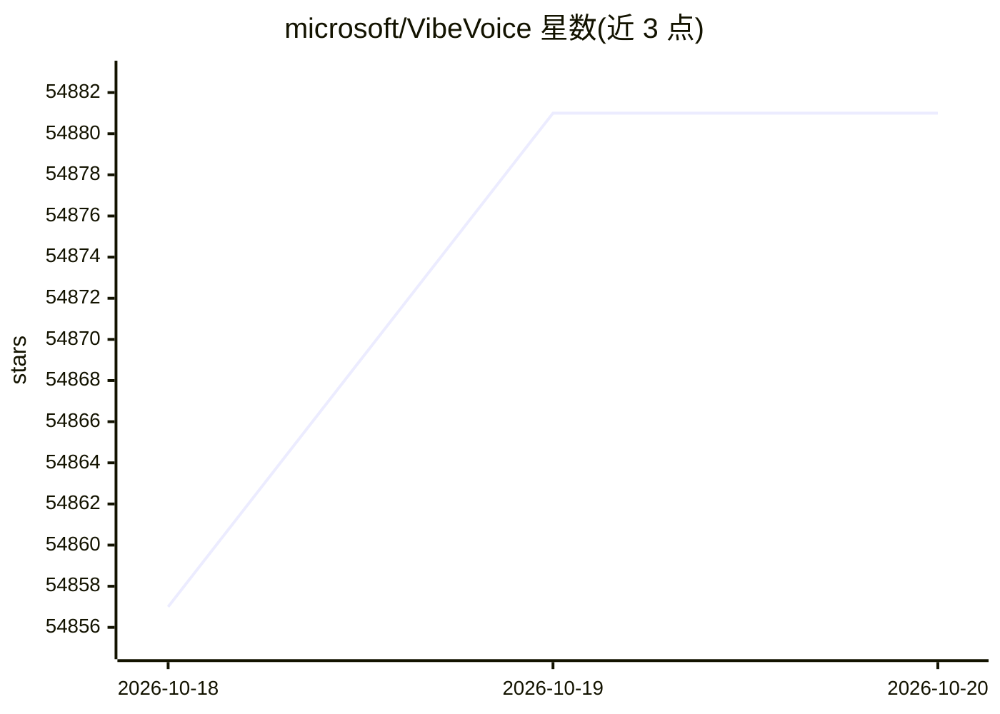

# microsoft/VibeVoice

⭐ 54,881 · Python · MIT · 推送 2026-10-08 · [GitHub](https://github.com/microsoft/VibeVoice) · [官网](https://microsoft.github.io/VibeVoice/) · 组织维护

**语音 AI 模型家族：长音频识别与多说话人语音生成**

微软开源的语音 AI 模型家族，含 TTS 与 ASR 两条线：ASR 模型单次处理 60 分钟长音频，联合输出说话人、时间戳与文本，支持自定义热词、流式识别与 50+ 语言；TTS 支持最长 90 分钟、最多 4 说话人的语音生成，另有 0.5B 实时流式 TTS（约 300 毫秒首响）。核心机制为 7.5 Hz 连续语音 tokenizer 与 next-token diffusion 框架。注意：TTS 代码已于 2025-09 从仓库移除，模型仅限研究用途。

## 筛选速览

| 维度 | 判定 | 备注 |
|---|---|---|
| AI 角色 | `ai-native` | 本体是模型或模型工具 |
| 许可风险 | `permissive` | MIT |
| 部署形态 | `None` |  |
| 模型依赖 | local-ok | 支持本地模型 |
| 硬件要求 | `cpu-ok` | |
| 安装摩擦 | `low` | 无编译、无系统依赖或容器化 |
| 成熟度 | — | 结构信号不足 |

## 动量与使用信号

- 维护:`active` — 距上次 push 10.1 天,年发版 0,22 位贡献者
- 涨星:近 1 天 **+10**(自 20261016 起算)

## 能力要点

- ASR 单次处理 60 分钟音频，联合输出说话人/时间戳/内容
- TTS 单次生成最长 90 分钟、最多 4 说话人的对话语音
- 0.5B 实时流式 TTS，支持流式文本输入
- ASR-BitNet 经量化压缩至 1.58 GB，可在 CPU 上实时推理

## 适用场景

- 将长会议或播客音频转写为含说话人与时间戳的结构化文本
- 用自定义热词提升领域术语的识别准确率
- 生成多说话人长对话语音用于研究实验
- 在 CPU 边缘设备上运行流式语音识别

## 场景标签

`语音识别` `语音合成` · 领域:内容生成

## 证据(README 行号)

> L40: VibeVoice is a **family of open-source frontier voice AI models** that includes both Text-to-Speech (TTS) and Autom
> L34: 2025-09-05: VibeVoice is an open-source research framework intended to advance collaboration in the speech synthesi
> L140: We do not recommend using VibeVoice in commercial or real-world applications without further testing and developme

## 星数曲线

2026-10-18 54,857 → 2026-10-20 54,881（+24）

---
*卡片 v1 · prompt 1.4 · 生成 2026-10-18 · 置信度 high · 依据 README sha `1f18ad932485` · [字段定义](../../DATASET.md)*
