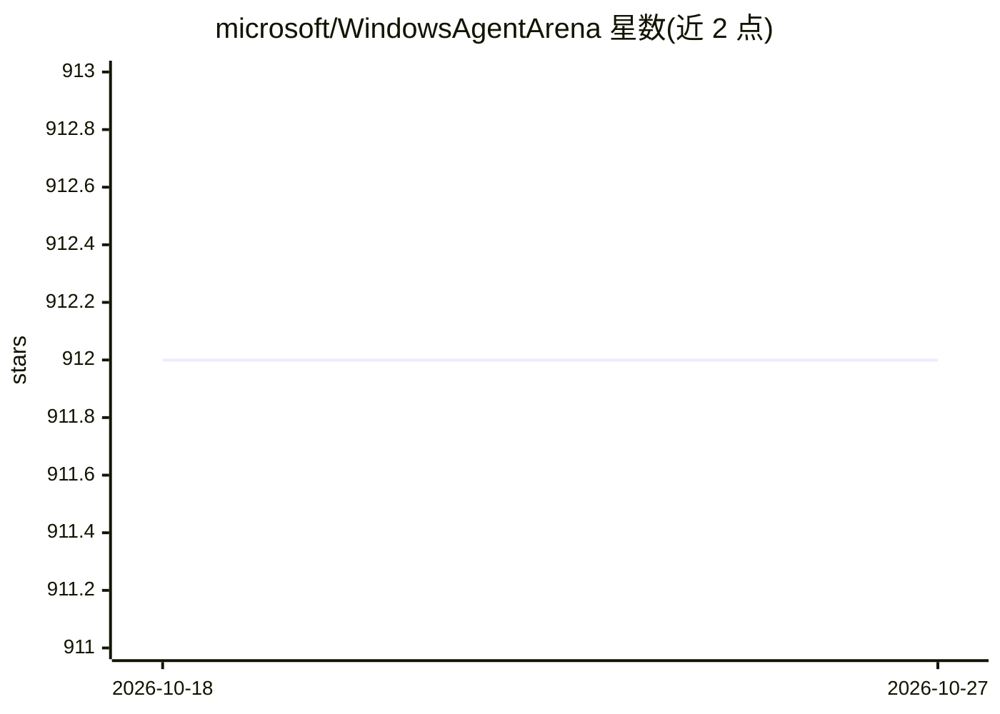

# microsoft/WindowsAgentArena

⭐ 912 · Python · MIT · 推送 2026-10-26 · [GitHub](https://github.com/microsoft/WindowsAgentArena) · [官网](https://microsoft.github.io/WindowsAgentArena) · 组织维护

**给 AI 研究者的 Windows 桌面 Agent 基准测试平台**

微软开源的 Windows 11 环境基准测试平台，用于测试与评测多模态桌面 AI Agent：在 Docker 容器内运行含预装程序的 Windows 11 虚拟机（30GB golden image），Agent 通过容器内 Python 服务器接收并执行命令完成多样任务。支持 Azure ML 云上并行运行数百任务以加速评测，内置 Navi Agent 及 Omniparser 屏幕理解等配置选项。本地部署需要 Docker（WSL2）、Python 3.9 与 OpenAI/Azure OpenAI API Key，提供 normal/hard 两种难度模式。

## 筛选速览

| 维度 | 判定 | 备注 |
|---|---|---|
| AI 角色 | `ai-ecosystem` | LLM/agent 周边工具 |
| 许可风险 | `permissive` | MIT |
| 部署形态 | `self-host` | docker 或自建部署 |
| 模型依赖 | locked-api |  |
| 硬件要求 | — | 无带数字的原话,不猜 |
| 安装摩擦 | `low` | 无编译、无系统依赖或容器化 |
| 成熟度 | — | 结构信号不足 |

## 能力要点

- 可复现的 Windows 11 桌面环境，托管执行 Agent 命令的 Python 服务器
- 支持 Azure ML 云端大规模并行评测（数百任务数分钟）
- 内置 Navi Agent，支持 Omniparser、accessibility tree 等多种屏幕理解配置
- 提供 normal 与 hard 两种任务难度模式

## 适用场景

- 评测我开发的桌面 Agent 在真实 Windows 任务上的表现
- 并行跑基准任务快速得到 Agent 得分
- 复现论文中 Navi Agent 的实验配置

## 场景标签

`模型评测` · 领域:评测与运维

## 证据(README 行号)

> L7: **Windows Agent Arena (WAA) 🪟** is a scalable Windows AI agent platform for testing and benchmarking multi-modal, de
> L9: WAA supports the deployment of agents **at scale** using the Azure ML cloud infrastructure, allowing for the paralle

## 星数曲线

2026-10-18 912 → 2026-10-27 912（+0）

---
*卡片 v1 · prompt 1.4 · 生成 2026-10-21 · 置信度 mid · 依据 README sha `803f2a2612fb` · [字段定义](../../DATASET.md)*
