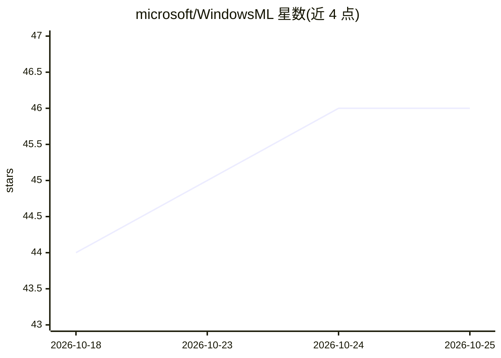

# microsoft/WindowsML

⭐ 46 · PowerShell · MIT · 推送 2026-10-16 · [GitHub](https://github.com/microsoft/WindowsML) · [官网](https://aka.ms/winml) · 组织维护

**Windows 本地 AI 推理框架：在 CPU/GPU/NPU 上运行 ONNX 模型**

微软维护的 Windows 本地 AI 推理框架，基于 ONNX Runtime 构建，通过 Windows 管理和更新的执行提供程序在 NPU、GPU、CPU 上加速推理。支持将 PyTorch、TensorFlow/Keras、TFLite、scikit-learn 等来源的模型转为 ONNX 使用；可作为共享系统组件被多个应用复用，无需在应用内捆绑运行时。以 NuGet 包形式提供，含 Windows App SDK 版本、独立版本与生成式 AI（Phi、Llama、Mistral、Gemma、DeepSeek 等）扩展包；仅面向 Windows 平台。

## 筛选速览

| 维度 | 判定 | 备注 |
|---|---|---|
| AI 角色 | `ai-ecosystem` | LLM/agent 周边工具 |
| 许可风险 | `permissive` | MIT |
| 部署形态 | `None` |  |
| 模型依赖 | — | README 未给出锁定关系 |
| 硬件要求 | — | 无带数字的原话,不猜 |
| 安装摩擦 | `low` | 无编译、无系统依赖或容器化 |
| 成熟度 | — | 结构信号不足 |

## 能力要点

- 基于 ONNX Runtime，支持 NPU/GPU/CPU 硬件加速推理
- 支持 PyTorch/TensorFlow/scikit-learn 等模型转换为 ONNX 运行
- 可作共享系统组件，多个应用共用同一运行时
- 生成式 AI 扩展包支持 Phi、Llama、Mistral、Gemma、DeepSeek 等模型

## 适用场景

- 在 Windows 应用中本地运行 AI 模型并调用 NPU 加速
- 将现有 PyTorch/TensorFlow 模型部署到 Windows 端侧
- 构建离线、保护数据隐私的端侧推理应用

## 场景标签

`推理引擎` · 领域:训练与推理

## 证据(README 行号)

> L6: Windows ML is the unified and high-performance local AI inferencing framework for Windows, powered by ONNX Runtime. 
> L12: Windows ML is Microsoft's recommended local AI inferencing framework for Windows — the official, Windows-native way

## 星数曲线

2026-10-18 44 → 2026-10-25 46（+2）

---
*卡片 v1 · prompt 1.4 · 生成 2026-10-25 · 置信度 high · 依据 README sha `3ee57de25be1` · [字段定义](../../DATASET.md)*
