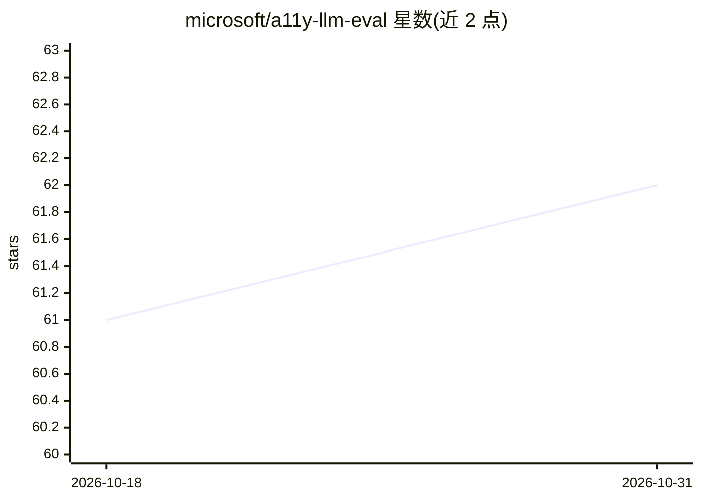

# microsoft/a11y-llm-eval

⭐ 62 · Python · MIT · 推送 2026-05-07 · [GitHub](https://github.com/microsoft/a11y-llm-eval) · [官网](https://microsoft.github.io/a11y-llm-eval-report/) · 组织维护

**评测 LLM 生成无障碍 HTML 能力的基准测试套件**

微软研究项目：用公开测试集基准测试各 LLM 生成可访问 HTML 的能力。生成阶段由 GitHub Copilot SDK 驱动的 agent 会话在 Docker 沙箱中完成，可对比控制组、自定义指令集与多轮技能三种变体；产物经 Playwright（Chromium）真实浏览器渲染后，用 axe-core 加自定义断言评估 WCAG 违规，支持多次采样与 pass@k 指标，输出 HTML 报告与成本统计。面向评测与无障碍研究者，需 Python 3.11+、Node.js 18+、Docker 与 GitHub CLI 认证。

## 筛选速览

| 维度 | 判定 | 备注 |
|---|---|---|
| AI 角色 | `ai-ecosystem` | LLM/agent 周边工具 |
| 许可风险 | `permissive` | MIT |
| 部署形态 | `self-host` | docker 或自建部署 |
| 模型依赖 | — | README 未给出锁定关系 |
| 硬件要求 | — | 无带数字的原话,不猜 |
| 安装摩擦 | `low` | 无编译、无系统依赖或容器化 |
| 成熟度 | — | 结构信号不足 |

## 能力要点

- axe-core + 逐用例自定义断言的双层无障碍评估，零 WCAG 失败且断言全过才算通过
- 支持控制组/自定义指令集/多轮 Skills 三种生成变体的对照基准
- 多样本生成与 pass@k 指标，附 token 与成本追踪
- 生成会话运行在自有 Docker 沙箱，支持 BYOK（Anthropic/OpenAI/Azure）密钥

## 适用场景

- 对比不同 LLM 生成可访问 HTML 代码的通过率
- 评估自定义无障碍指令或技能对模型输出的改进效果
- 为无障碍代码生成研究提供公开基准数据

## 场景标签

`模型评测` · 领域:评测与运维

## 证据(README 行号)

> L3: This is a research project to evaluate how well various LLM models generate accessible HTML content.
> L9: Create a public test suite which can be used to benchmark how well various LLMs generates accessible HTML code. Even
> L21: - Python orchestrator built on the GitHub Copilot SDK

## 星数曲线

2026-10-18 61 → 2026-10-31 62（+1）

---
*卡片 v1 · prompt 1.4 · 生成 2026-10-24 · 置信度 mid · 依据 README sha `4ad7d4fafe80` · [字段定义](../../DATASET.md)*
