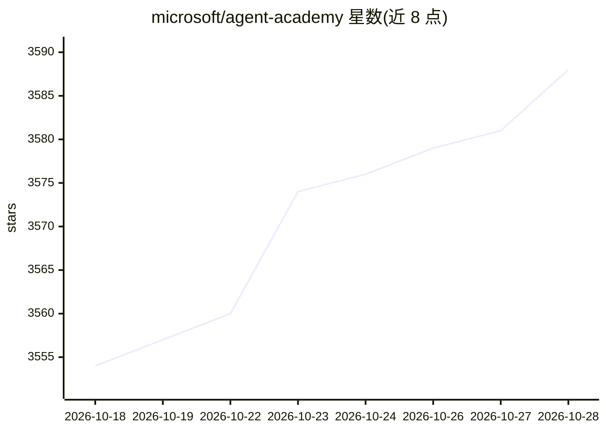

# microsoft/agent-academy

⭐ 3,595 · JavaScript · MIT · 推送 2026-10-25 · [GitHub](https://github.com/microsoft/agent-academy) · [官网](https://aka.ms/agent-academy) · 组织维护

**微软官方 Copilot Studio 智能体开发三讲课程**

微软维护的 Copilot Studio Agent Academy 课程仓库：面向希望使用 Microsoft Copilot Studio 构建智能体的用户，提供三部分课程，正文托管在外部站点 aka.ms/agent-academy，仓库仅作课程入口并附贡献与商标说明。README 未展示具体课程内容、安装步骤或运行方式。

## 筛选速览

| 维度 | 判定 | 备注 |
|---|---|---|
| AI 角色 | `ai-knowledge` | 知识聚合/清单类 |
| 许可风险 | `permissive` | MIT |
| 部署形态 | `None` |  |
| 模型依赖 | — | README 未给出锁定关系 |
| 硬件要求 | — | 无带数字的原话,不猜 |
| 安装摩擦 | `low` | 无编译、无系统依赖或容器化 |
| 成熟度 | — | 结构信号不足 |

## 能力要点

- 三部分课程的托管仓库
- 课程内容位于外部站点 aka.ms/agent-academy

## 适用场景

- 想入门用 Copilot Studio 构建智能体的学习者跟随课程学习

## 场景标签

`教程课程` · 领域:学习与行业

## 证据(README 行号)

> L3: This repo is for hosting a three part course for people who want to build agents with Microsoft Copilot Studio.

## 星数曲线

2026-10-18 3,554 → 2026-10-28 3,588（+34）

---
*卡片 v1 · prompt 1.4 · 生成 2026-10-20 · 置信度 mid · 依据 README sha `fb07dc8a57ac` · [字段定义](../../DATASET.md)*
