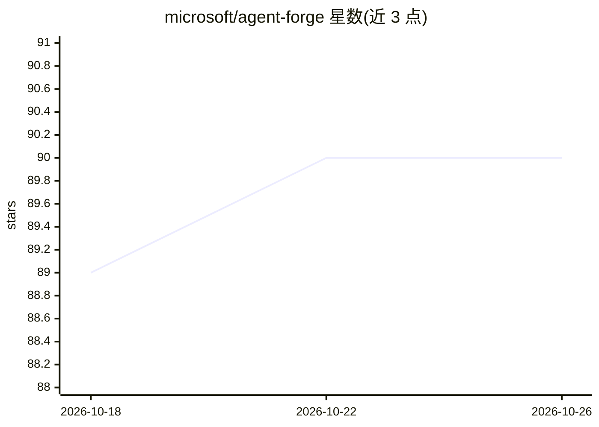

# microsoft/agent-forge

⭐ 90 · TypeScript · MIT · 推送 2026-04-16 · [GitHub](https://github.com/microsoft/agent-forge) · 组织维护

**为 VS Code 项目生成 GitHub Copilot 定制配置文件的多智能体工具**

微软维护的上下文工程工具包：用户描述需求（或扫描既有代码库），由规划智能体提取技术栈并分解领域，7 个专职写作智能体生成 7 类 Copilot 定制文件（agent/prompt/instruction/skill/hook/MCP 配置/workflow），随后校验 YAML、工具名与内容质量并自动修复，经智能合并安装到 .github/ 与 .vscode/。生成管线依赖 Node.js 18+、VS Code、GitHub Copilot 扩展与 Copilot CLI；Git/GitHub CLI/Docker 为可选。也可跳过 AI 直接安装预置模板。以 npm CLI 形式分发。

## 筛选速览

| 维度 | 判定 | 备注 |
|---|---|---|
| AI 角色 | `ai-ecosystem` | LLM/agent 周边工具 |
| 许可风险 | `permissive` | MIT |
| 部署形态 | `library` | 以包/库形式分发 |
| 模型依赖 | — | README 未给出锁定关系 |
| 硬件要求 | — | 无带数字的原话,不猜 |
| 安装摩擦 | `low` | 无编译、无系统依赖或容器化 |
| 成熟度 | — | 结构信号不足 |

## 能力要点

- plan-then-execute 多智能体管线：规划者分解领域，7 个写作智能体生成 7 类制品
- Greenfield（从描述生成）与 Brownfield（扫描既有代码库）两种模式
- 生成后校验 YAML frontmatter、工具名、glob 模式与内容质量并自动修复
- 智能合并：仅覆盖本工具标记生成的文件，保留用户自建文件

## 适用场景

- 为 VS Code 项目自动生成 Copilot 的 agent、指令与斜杠命令配置
- 扫描既有代码库，生成与技术栈匹配的 Copilot 定制文件
- 跳过 AI，直接安装预置模板（code-review、testing 等）

## 场景标签

`多智能体` `代码生成` · 领域:Agent 开发

## 证据(README 行号)

> L10: AGENT-FORGE is a Context Engineering Toolkit that generates GitHub Copilot customization files for your VS Code pro
> L46: AGENT-FORGE uses a **plan-then-execute** architecture powered by GitHub Copilot CLI:
> L66: - **GitHub Copilot CLI** — powers the generation pipeline

## 星数曲线

2026-10-18 89 → 2026-10-26 90（+1）

---
*卡片 v1 · prompt 1.4 · 生成 2026-10-23 · 置信度 high · 依据 README sha `ae81c6418c34` · [字段定义](../../DATASET.md)*
