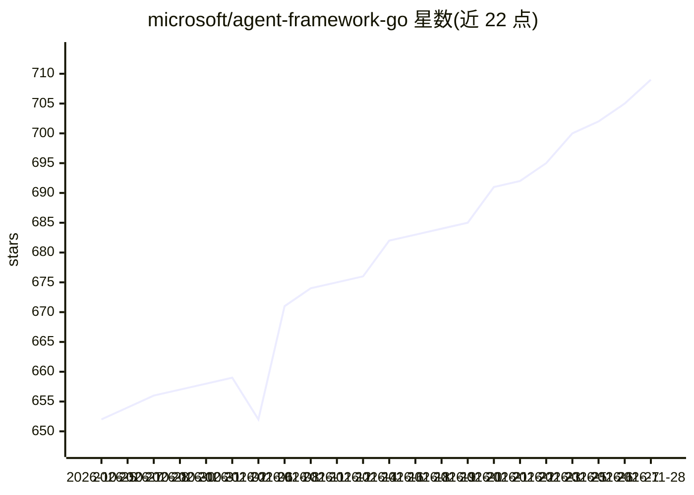

# microsoft/agent-framework-go

⭐ 709 · Go · MIT · 推送 2026-11-27 · [GitHub](https://github.com/microsoft/agent-framework-go) · [官网](https://aka.ms/agent-framework) · 组织维护

**微软 Go 版 Agent 框架：构建与编排生产级多智能体工作流**

Microsoft Agent Framework 的 Go 实现，面向需要把 agent 从原型推进到生产的团队，提供构建、编排与运行多智能体系统的统一基础。核心机制包括图式工作流（顺序/并发/群协作/条件路由）、checkpoint 与可恢复执行、OpenTelemetry 可观测性、中间件（工具审批、日志）、RAG 文本搜索、向量存储与记忆，以及 Foundry/Azure OpenAI/OpenAI/MCP/A2A 等生态接入。Go SDK 处于公开预览阶段，部分能力（声明式 agent、handoff 编排、AF Labs、DevUI 等）尚未实现。

## 筛选速览

| 维度 | 判定 | 备注 |
|---|---|---|
| AI 角色 | `ai-ecosystem` | LLM/agent 周边工具 |
| 许可风险 | `permissive` | MIT |
| 部署形态 | `None` |  |
| 模型依赖 | locked-api |  |
| 硬件要求 | — | 无带数字的原话,不猜 |
| 安装摩擦 | `low` | 无编译、无系统依赖或容器化 |
| 成熟度 | `idea` | |

## 能力要点

- 图式多智能体工作流：顺序、并发、群协作、条件路由、子工作流、checkpoint 与 human-in-the-loop
- OpenTelemetry 分布式追踪与中间件机制（日志、工具审批、自动工具调用）
- RAG 文本搜索、向量存储、嵌入生成与会话记忆（含 Cosmos DB 持久化聊天历史）
- 支持 Microsoft Foundry、Azure OpenAI、OpenAI、MCP、A2A、AG-UI 等生态

## 适用场景

- 用 Go 构建需要 checkpoint、可恢复与可观测的生产级 agent 系统
- 编排多个 agent 协作完成顺序、并发或群组工作流
- 为 agent 接入外部知识库实现 RAG 检索与引用
- 通过 MCP/A2A 等协议让 agent 与外部工具和其他 agent 互操作

## 场景标签

`Agent 框架` `多智能体` `工作流自动化` · 领域:Agent 开发

## 证据(README 行号)

> L10: Microsoft Agent Framework (MAF) is an open, multi-language framework for building **production-grade AI agents and 
> L12: Microsoft Agent Framework is built for teams taking agents from prototype to production. It provides a consistent f

## 星数曲线

2026-10-25 652 → 2026-11-28 709（+57）

---
*卡片 v1 · prompt 1.4 · 生成 2026-11-25 · 置信度 high · 依据 README sha `624922789d59` · [字段定义](../../DATASET.md)*
