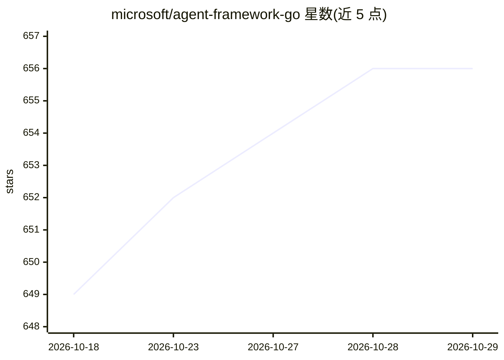

# microsoft/agent-framework-go

⭐ 656 · Go · MIT · 推送 2026-10-28 · [GitHub](https://github.com/microsoft/agent-framework-go) · [官网](https://aka.ms/agent-framework) · 组织维护

**微软多语言 Agent 框架的 Go 实现：构建与编排生产级多 agent 工作流**

Microsoft Agent Framework 的 Go 语言实现，提供构建、编排和运行生产级 AI agent 与多 agent 工作流的基础设施：包括多 provider 支持、中间件、基于图的工作流（顺序/并发/分组协作/条件路由/检查点/人工介入）、OpenTelemetry 可观测性、Agent Skills、RAG 检索、向量存储与嵌入生成。面向将 agent 从原型推向生产阶段的开发团队。当前处于 public preview，部分功能（声明式 agent、DevUI、Foundry 托管部署等）尚未在 Go SDK 实现。通过 go get 安装。

## 筛选速览

| 维度 | 判定 | 备注 |
|---|---|---|
| AI 角色 | `ai-ecosystem` | LLM/agent 周边工具 |
| 许可风险 | `permissive` | MIT |
| 部署形态 | `None` |  |
| 模型依赖 | locked-api |  |
| 硬件要求 | — | 无带数字的原话,不猜 |
| 安装摩擦 | `low` | 无编译、无系统依赖或容器化 |
| 成熟度 | `idea` | |

## 能力要点

- 图式工作流：顺序/并发/分组协作/条件路由/子工作流/检查点/时间旅行模式
- 多 LLM 与 agent provider 支持，含 Microsoft Foundry/Azure OpenAI/OpenAI
- OpenTelemetry 分布式追踪集成
- Agent Skills、RAG 文本检索、向量存储与嵌入生成

## 适用场景

- 用 Go 构建面向生产的多 agent 编排系统
- 为 agent 应用接入检查点、人工介入与可观测性能力
- 使用向量存储与 RAG 为 agent 提供外部知识

## 场景标签

`Agent 框架` `多智能体` · 领域:Agent 开发

## 证据(README 行号)

> L10: Microsoft Agent Framework (MAF) is an open, multi-language framework for building **production-grade AI agents and 
> L12: Microsoft Agent Framework is built for teams taking agents from prototype to production. It provides a consistent f

## 星数曲线

2026-10-18 649 → 2026-10-29 656（+7）

---
*卡片 v1 · prompt 1.4 · 生成 2026-10-21 · 置信度 high · 依据 README sha `e68acdff364f` · [字段定义](../../DATASET.md)*
