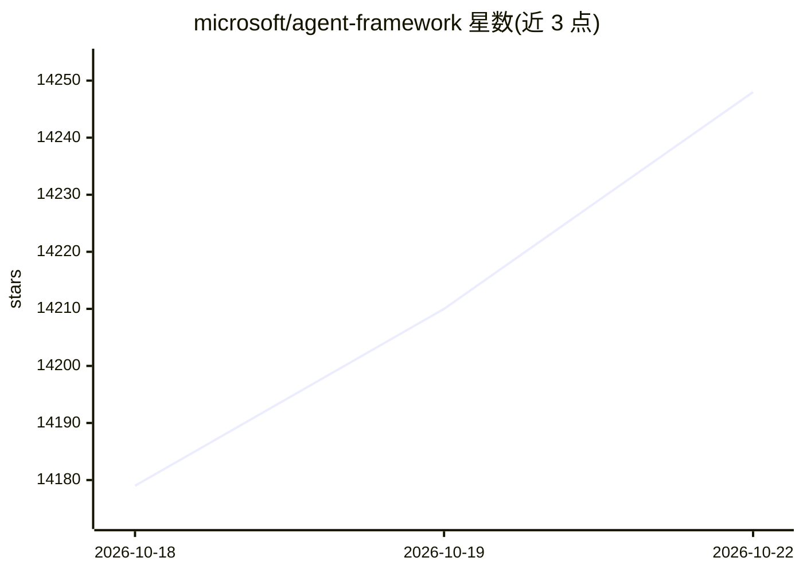

# microsoft/agent-framework

⭐ 14,248 · Python · MIT · 推送 2026-10-21 · [GitHub](https://github.com/microsoft/agent-framework) · [官网](https://aka.ms/agent-framework) · 组织维护

**面向团队构建生产级 AI agent 与多 agent 工作流的多语言框架**

Microsoft Agent Framework（MAF）是支持 Python、.NET 与 Go 的多语言开源框架，用于构建、编排与部署 AI agent 及多 agent 工作流。面向要把 agent 从原型推进到生产的团队，提供图式编排（顺序、并发、handoff、群协作）、检查点与断点恢复、OpenTelemetry 可观测性、YAML 声明式 agent、中间件管道与 DevUI 调试界面；通过 PyPI（agent-framework）与 NuGet（Microsoft.Agents.AI）分发，另有 AF Labs 实验包与从 Semantic Kernel、AutoGen 迁移的指南。

## 筛选速览

| 维度 | 判定 | 备注 |
|---|---|---|
| AI 角色 | `ai-native` | 本体是模型或模型工具 |
| 许可风险 | `permissive` | MIT |
| 部署形态 | `library` | 以包/库形式分发 |
| 模型依赖 | locked-api |  |
| 硬件要求 | — | 无带数字的原话,不猜 |
| 安装摩擦 | `medium` | 含编译或系统依赖之一 |
| 成熟度 | — | 结构信号不足 |

## 动量与使用信号

- 维护:`active` — 距上次 push 1.4 天,年发版 100,296 位贡献者
- 涨星:近 1 天 **+26**(自 20261016 起算)
- 安装:pypi 包 `agent-framework` 月下载 189,927
- 平台:WINDOWS · 协议:—

## 能力要点

- 支持 Python、.NET 与 Go，跨语言一致 API
- 图式多 agent 工作流：顺序/并发/handoff/群协作，含检查点、human-in-the-loop 与 time-travel
- 内置 OpenTelemetry 分布式追踪；YAML 声明式定义 agent
- Foundry 托管部署（2 行代码）与 DevUI 开发调试界面

## 适用场景

- 构建需在生产环境运行、要求可恢复与可治理的 agent 应用
- 编排多 agent 协作工作流（handoff、群聊等模式）
- 从 Semantic Kernel 或 AutoGen 迁移现有 agent 项目
- 将 agent 部署到 Foundry 托管基础设施或云端

## 场景标签

`Agent 框架` `多智能体` · 领域:Agent 开发

## 证据(README 行号)

> L11: Microsoft Agent Framework (MAF) is an open, multi-language framework for building **production-grade AI agents and 
> L13: Microsoft Agent Framework is built for teams taking agents from prototype to production. It provides a consistent f
> L46: - **Orchestration Patterns & Workflows**: Build multi-agent systems with graph-based workflows supporting sequentia

## 星数曲线

2026-10-18 14,179 → 2026-10-22 14,248（+69）

---
*卡片 v1 · prompt 1.4 · 生成 2026-10-18 · 置信度 high · 依据 README sha `1eb7fedb4d96` · [字段定义](../../DATASET.md)*
