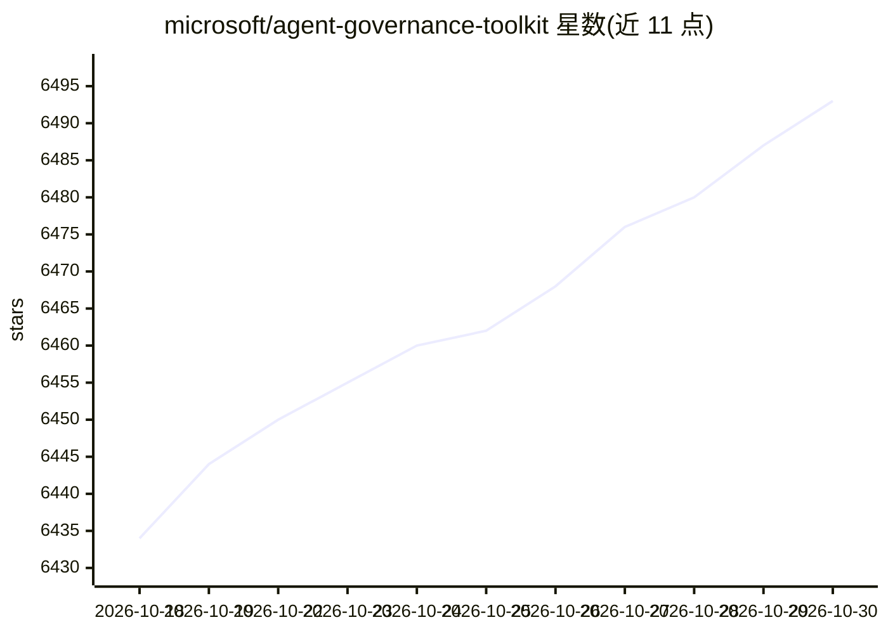

# microsoft/agent-governance-toolkit

⭐ 6,493 · Python · MIT · 推送 2026-10-29 · [GitHub](https://github.com/microsoft/agent-governance-toolkit) · 组织维护 · 中文 README

**面向自治 AI agent 的治理工具包：策略执行、身份、沙箱与审计**

微软维护的 AI agent 治理框架：在应用层拦截 agent 的工具调用、消息发送与委派，按 YAML/OPA/Cedar 策略做确定性、fail-closed 的允许/拒绝判定，并输出防篡改审计日志；另含零信任身份（SPIFFE/DID/mTLS）、四环执行沙箱、kill switch/SLO 监控、OWASP Agentic Top 10 合规校验 CLI 与提示注入审计。以 pip/npm/dotnet/cargo/go 多语言 SDK 提供，通过中间件或适配器接入 LangGraph、CrewAI、AutoGen 等框架。Python 3.11+，v4.1.0 将 45 个包整合为 5 个发行版，标注 Public Preview 可能有破坏性变更。

## 筛选速览

| 维度 | 判定 | 备注 |
|---|---|---|
| AI 角色 | `ai-ecosystem` | LLM/agent 周边工具 |
| 许可风险 | `permissive` | MIT |
| 部署形态 | `self-host` | docker 或自建部署 |
| 模型依赖 | — | README 未给出锁定关系 |
| 硬件要求 | — | 无带数字的原话,不猜 |
| 安装摩擦 | `low` | 无编译、无系统依赖或容器化 |
| 成熟度 | `idea` | |

## 能力要点

- govern() 两行包装工具函数：每次调用按策略判定并记录审计日志
- 覆盖 OWASP Agentic Top 10，agt CLI 提供 OWASP 校验、策略 lint 与红队扫描
- 五种语言 SDK（Python/TypeScript/.NET/Rust/Go）实现核心治理能力
- MCP 安全网关：工具投毒检测、漂移监控、隐藏指令扫描

## 适用场景

- 生产环境对 agent 的数据库/邮件等工具调用做策略审批与拦截
- 多 agent 系统中区分各 agent 身份并留存防篡改审计记录
- CI 中对 agent 系统做 OWASP 合规校验与提示注入审计

## 场景标签

`网络安全` · 领域:学习与行业

## 证据(README 行号)

> L33: Policy enforcement, identity, sandboxing, and SRE for autonomous AI agents. One `pip install`, any framework.
> L176: Agent ──► Policy Engine ──► Identity ──► Audit Log
> L223: All five language SDKs implement core governance (policy, identity, trust, audit). Python has the full stack. Copi

## 星数曲线

2026-10-18 6,434 → 2026-10-30 6,493（+59）

---
*卡片 v1 · prompt 1.4 · 生成 2026-10-20 · 置信度 mid · 依据 README sha `cf93b006fc88` · [字段定义](../../DATASET.md)*
