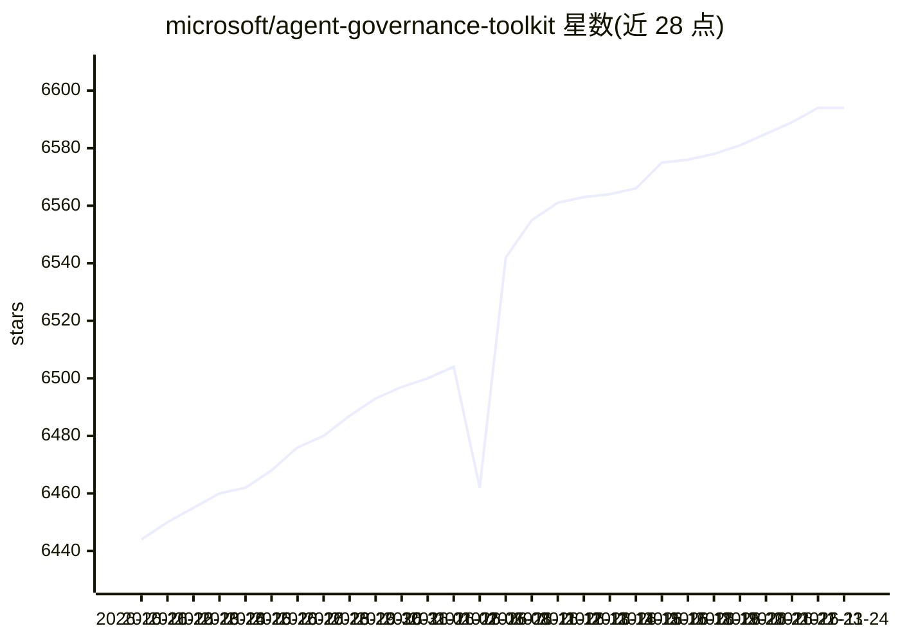

# microsoft/agent-governance-toolkit

⭐ 6,594 · Python · MIT · 推送 2026-11-21 · [GitHub](https://github.com/microsoft/agent-governance-toolkit) · 组织维护

**为自主 AI Agent 提供策略执行、身份与沙箱治理的工具包**

微软出品的 Agent 治理工具包：在应用代码层拦截每次工具调用、消息发送与代理委托，依据 YAML/OPA/Cedar 策略做确定性 fail-closed 判定，记录防篡改审计日志；配套零信任身份（SPIFFE/DID/mTLS）、四特权环执行沙箱、kill switch 与 SLO 监控。提供 Python/TypeScript/.NET/Rust/Go 五种 SDK 与 agt CLI（合规校验、提示注入审计），并支持 Claude Code 等插件式接入。需 Python 3.10+，Azure 集成为可选。

## 筛选速览

| 维度 | 判定 | 备注 |
|---|---|---|
| AI 角色 | `ai-ecosystem` | LLM/agent 周边工具 |
| 许可风险 | `permissive` | MIT |
| 部署形态 | `self-host` | docker 或自建部署 |
| 模型依赖 | — | README 未给出锁定关系 |
| 硬件要求 | — | 无带数字的原话,不猜 |
| 安装摩擦 | `low` | 无编译、无系统依赖或容器化 |
| 成熟度 | — | 结构信号不足 |

## 能力要点

- 每次工具调用经确定性策略引擎判定，拒绝时抛出 GovernanceDenied
- 防篡改审计日志记录策略版本、请求与允许/拒绝原因
- 五语言 SDK（Python/TS/.NET/Rust/Go）+ agt CLI（agt verify/red-team 等）
- 覆盖 10/10 OWASP Agentic Top 10（自述）

## 适用场景

- 多 Agent 系统中为每次工具调用做策略准入与审计
- 满足审计/监管对决策记录的可追溯要求
- 对 prompts 做提示注入红队扫描并纳入 CI 门禁

## 场景标签

`Agent 框架` `网络安全` · 领域:Agent 开发

## 证据(README 行号)

> L30: Policy enforcement, identity, sandboxing, and SRE for autonomous AI agents. One `pip install`, any framework.
> L44: AGT does not try to win that fight inside the prompt. Every tool call, message send, and delegation is intercepted 
> L173: Agent ──► Policy Engine ──► Identity ──► Audit Log

## 星数曲线

2026-10-21 6,444 → 2026-11-24 6,594（+150）

---
*卡片 v1 · prompt 1.4 · 生成 2026-11-22 · 置信度 mid · 依据 README sha `570725821dd4` · [字段定义](../../DATASET.md)*
