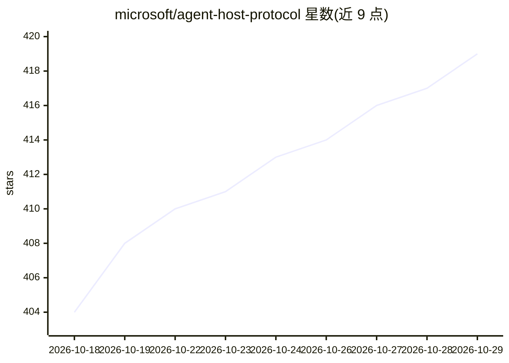

# microsoft/agent-host-protocol

⭐ 419 · TypeScript · MIT · 推送 2026-10-27 · [GitHub](https://github.com/microsoft/agent-host-protocol) · [官网](https://microsoft.github.io/agent-host-protocol/) · 组织维护

**微软的 AI agent 会话多客户端状态同步协议**

Agent Host Protocol（AHP）定义便携独立会话服务器与客户端之间的通信方式：多个客户端连接同一服务器，通过不可变状态、纯 reducer 与预写协调看到同步的 AI agent 会话视图。提供 Rust、TypeScript、Kotlin、Go、Swift、.NET 六种官方客户端库及 MultiHostClient，列出 VS Code agent host、pi-ahp、ahpd、hydra-ahp、AHP-ACP Gateway 等服务器实现。面向构建 agent 会话客户端/宿主的开发者，MIT 许可，各客户端与规范独立按 SemVer 发布。

## 筛选速览

| 维度 | 判定 | 备注 |
|---|---|---|
| AI 角色 | `ai-ecosystem` | LLM/agent 周边工具 |
| 许可风险 | `permissive` | MIT |
| 部署形态 | `library` | 以包/库形式分发 |
| 模型依赖 | — | README 未给出锁定关系 |
| 硬件要求 | — | 无带数字的原话,不猜 |
| 安装摩擦 | `medium` | 含编译或系统依赖之一 |
| 成熟度 | — | 结构信号不足 |

## 能力要点

- 多客户端同步查看 AI agent 会话，采用不可变状态与纯 reducer
- 六种语言官方客户端库（Rust/TS/Kotlin/Go/Swift/.NET）
- MultiHostClient 支持同时连接两个以上宿主
- 列出多个开源 AHP 服务器实现（VS Code agent host、ahpd、AHP-ACP Gateway 等）

## 适用场景

- 为 agent 客户端与宿主实现统一会话协议接入
- 多客户端（编辑器、终端、微信等）同步同一 agent 会话
- 基于规范自建 AHP 宿主或客户端

## 场景标签

 · 领域:AI agent 基础设施/协议

## 证据(README 行号)

> L3: A synchronized, multi-client state protocol for AI agent sessions.
> L9: The Agent Host Protocol (AHP) defines how a portable, standalone sessions server communicates with its clients. Mult

## 星数曲线

2026-10-18 404 → 2026-10-29 419（+15）

---
*卡片 v1 · prompt 1.4 · 生成 2026-10-21 · 置信度 high · 依据 README sha `0147610b3ef2` · [字段定义](../../DATASET.md)*
