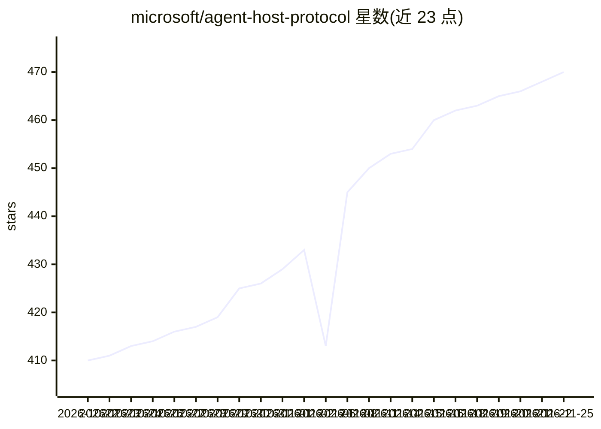

# microsoft/agent-host-protocol

⭐ 470 · TypeScript · MIT · 推送 2026-11-24 · [GitHub](https://github.com/microsoft/agent-host-protocol) · [官网](https://microsoft.github.io/agent-host-protocol/) · 组织维护

**AI agent 会话的多客户端同步状态协议，供服务端与客户端接入**

Agent Host Protocol (AHP) 定义便携式独立会话服务器与客户端之间的通信方式，多个客户端连接服务器后通过不可变状态、纯 reducer 与写前协调看到同步的 AI agent 会话视图。提供 Rust、TypeScript、Kotlin、Go、Swift、.NET 六种语言的客户端库，并列出 VS Code、CLI、TUI、Web 等客户端与多个服务器实现。各语言客户端与规范按 SemVer 独立发布，仓库以 npm 管理文档与开发依赖。

## 筛选速览

| 维度 | 判定 | 备注 |
|---|---|---|
| AI 角色 | `ai-ecosystem` | LLM/agent 周边工具 |
| 许可风险 | `permissive` | MIT |
| 部署形态 | `library` | 以包/库形式分发 |
| 模型依赖 | — | README 未给出锁定关系 |
| 硬件要求 | — | 无带数字的原话,不猜 |
| 安装摩擦 | `medium` | 含编译或系统依赖之一 |
| 成熟度 | — | 结构信号不足 |

## 能力要点

- 定义多客户端同步会话状态的协议规范（不可变状态 + 纯 reducer + 写前协调）
- 提供 Rust/TypeScript/Kotlin/Go/Swift/.NET 六种语言客户端库
- 列出多款客户端（VS Code、CLI/TUI、Web）与服务器实现
- 各语言客户端与规范独立 SemVer 版本管理

## 适用场景

- 为 coding agent 会话构建多客户端同步的 UI 接入
- 自建 AHP 服务器或客户端库对接 agent 会话
- 通过 MCP server 终端客户端让人与 agent 共享会话

## 场景标签

 · 领域:LLM 基础设施/agent 协议

## 证据(README 行号)

> L3: A synchronized, multi-client state protocol for AI agent sessions.
> L9: The Agent Host Protocol (AHP) defines how a portable, standalone sessions server communicates with its clients. Mult

## 星数曲线

2026-10-22 410 → 2026-11-25 470（+60）

---
*卡片 v1 · prompt 1.4 · 生成 2026-11-25 · 置信度 high · 依据 README sha `d34d27c322e3` · [字段定义](../../DATASET.md)*
