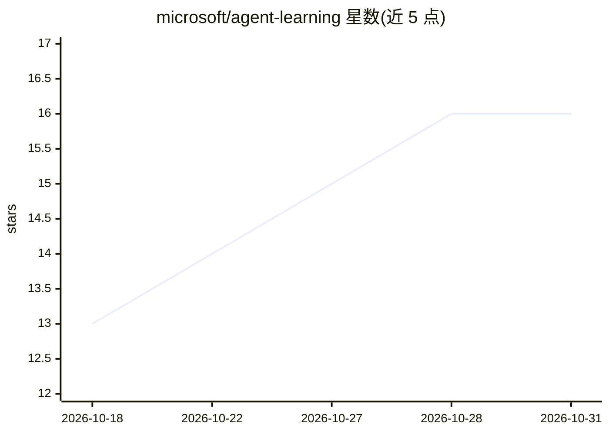

# microsoft/agent-learning

⭐ 16 · Python · MIT · 推送 2026-10-30 · [GitHub](https://github.com/microsoft/agent-learning) · 组织维护

**给 agent 开发者的可复用决策学习层，用反馈改进任务决策**

面向已有 agent 的轻量决策层：每个循环出现的任务决策由一个 TaskPolicy 管理，在少量可执行备选项中做选择。低权限策略用 REINFORCE-with-baseline 从本地评分的结果中学习；全权限策略用贝叶斯决策理论、硬约束与信息增益推理。基础模型保持冻结，无 GPU 训练，更新在 CPU 上的 Python 进程内完成。评分默认本地，Azure AI 评估器为可选；存储支持内存、本地 JSON 或 Azure Cosmos DB。提供 Windows/Linux 独立 CLI、PyPI SDK 与可选 PySpark 集成。

## 筛选速览

| 维度 | 判定 | 备注 |
|---|---|---|
| AI 角色 | `ai-ecosystem` | LLM/agent 周边工具 |
| 许可风险 | `permissive` | MIT |
| 部署形态 | `desktop` | 安装包/桌面程序 |
| 模型依赖 | — | README 未给出锁定关系 |
| 硬件要求 | — | 无带数字的原话,不猜 |
| 安装摩擦 | `low` | 无编译、无系统依赖或容器化 |
| 成熟度 | — | 结构信号不足 |

## 能力要点

- TaskPolicy 按决策权限（low/full）分别用 REINFORCE 学习或贝叶斯推理选择动作
- 基础模型冻结，无 GPU 训练，CPU 小步更新
- 本地评分默认，Azure AI 评估器与 Cosmos DB 为可选项
- 提供 Windows/Linux 独立 CLI 安装包、PyPI SDK 与 PySpark 可选集成

## 适用场景

- 让 agent 在检索策略、模型、工具、工作流等重复决策中依据反馈自动改进
- 通过证据门槛或用户显式接受逐步获得自主执行授权
- 记录并审计 agent 决策的episode 与结果评分

## 场景标签

`强化学习` · 领域:训练与推理

## 证据(README 行号)

> L5: `agent-learning` is a lightweight decision layer for an existing agent. One
> L6: TaskPolicy owns each recurring agent-task decision and its small, explicit set

## 星数曲线

2026-10-18 13 → 2026-10-31 16（+3）

---
*卡片 v1 · prompt 1.4 · 生成 2026-10-30 · 置信度 high · 依据 README sha `4b896d271f98` · [字段定义](../../DATASET.md)*
