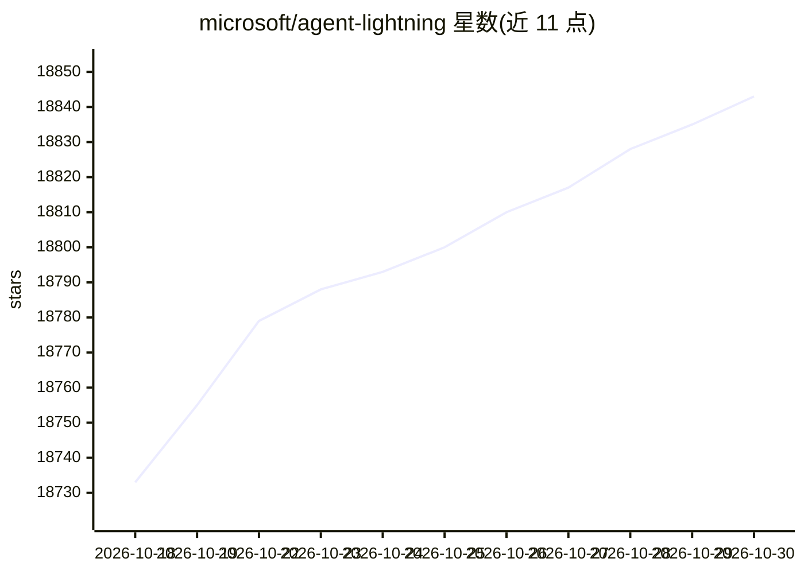

# microsoft/agent-lightning

⭐ 18,843 · Python · MIT · 推送 2026-10-20 · [GitHub](https://github.com/microsoft/agent-lightning) · [官网](https://microsoft.github.io/agent-lightning/) · 组织维护 · 中文 README

**面向开发者的 agent 强化学习训练框架**

约 3,500 行代码的 agentic RL 训练框架：agent 通过其代理捕获模型交互并转为训练数据，训练器基于 verl 与 vLLM 更新策略，rollout controller 支持本地运行或以 Kubernetes Job 运行 agent。README 称 agent 侧零代码改动即可接入训练，同时保留工具、上下文与控制流。安装依赖 CUDA 12.8+ GPU 环境与 uv、verl 脚本。提供 Calc-X、Search-R1、Coding Agent 等 7 个示例。

## 筛选速览

| 维度 | 判定 | 备注 |
|---|---|---|
| AI 角色 | `ai-native` | 本体是模型或模型工具 |
| 许可风险 | `permissive` | MIT |
| 部署形态 | `None` |  |
| 模型依赖 | local-ok | 支持本地模型 |
| 硬件要求 | — | 无带数字的原话,不猜 |
| 安装摩擦 | `medium` | 含编译或系统依赖之一 |
| 成熟度 | — | 结构信号不足 |

## 动量与使用信号

- 维护:`active` — 距上次 push 9.0 天,年发版 7,49 位贡献者
- 涨星:近 1 天 **+9**(自 20261016 起算)
- 平台:— · 协议:OPENAI-API / MCP

## 能力要点

- 通过 API 代理捕获训练数据，agent 侧零改动接入训练
- 原生支持 Kubernetes，agent 可作为 K8s Job 运行
- 提供完整 Coding Agent 训练管线（数据清洗、reward-hacking 防护、训练脚本）
- 训练栈基于 verl 与 vLLM

## 适用场景

- 用强化学习训练自己的编码/检索/工具调用 agent
- 在 Kubernetes 集群上跑 agent RL 训练任务
- 复现 Search-R1、SWE-bench 等 agent 训练实验

## 场景标签

`强化学习` `MLOps` · 领域:训练与推理

## 证据(README 行号)

> L3:  3,500-Line Lightweight Agentic RL Framework for Training Agents with Real Harnesses!
> L19: - 🧩 **Train with real agent harnesses:** Agents interact with the model through the Agent Lightning v1.0 proxy with
> L41: - **Trainer:** Runs `verl` and vLLM, builds training samples, and updates the policy.

## 星数曲线

2026-10-18 18,733 → 2026-10-30 18,843（+110）

---
*卡片 v1 · prompt 1.4 · 生成 2026-10-18 · 置信度 high · 依据 README sha `94c79b728a57` · [字段定义](../../DATASET.md)*
