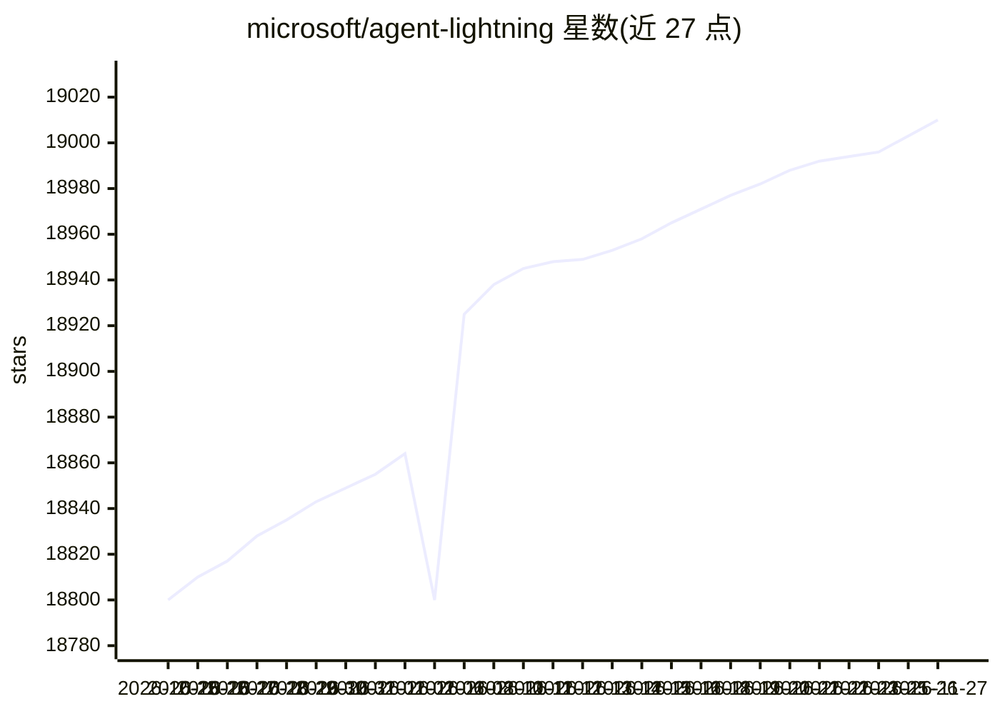

# microsoft/agent-lightning

⭐ 19,010 · Python · MIT · 推送 2026-11-26 · [GitHub](https://github.com/microsoft/agent-lightning) · [官网](https://microsoft.github.io/agent-lightning/) · 组织维护 · 中文 README

**以 RL 训练 AI agent 的轻量框架，agent 无需改代码**

微软开源的约 3,500 行代码的 agentic RL 训练框架。agent 通过其 API 代理与模型交互，保持原有工具、上下文、控制流与环境不变的情况下捕获交互转为训练数据，用 verl 与 vLLM 更新策略。架构由 Trainer、API Gateway、Rollout Controller 三组件组成，支持将 agent 作为 Kubernetes Job 运行。提供 Search R1、LLM-in-Sandbox、Coding Agent 等示例及完整训练流水线。需要 CUDA GPU 环境，通过 uv sync 与 verl 安装脚本部署。

## 筛选速览

| 维度 | 判定 | 备注 |
|---|---|---|
| AI 角色 | `ai-ecosystem` | LLM/agent 周边工具 |
| 许可风险 | `permissive` | MIT |
| 部署形态 | `None` |  |
| 模型依赖 | local-ok | 支持本地模型 |
| 硬件要求 | — | 无带数字的原话,不猜 |
| 安装摩擦 | `medium` | 含编译或系统依赖之一 |
| 成熟度 | — | 结构信号不足 |

## 动量与使用信号

- 维护:`active` — 距上次 push 9.0 天,年发版 7,49 位贡献者
- 涨星:近 1 天 **+9**(自 20261016 起算)
- 平台:— · 协议:OPENAI-API / MCP

## 能力要点

- ~3,500 行代码的轻量 RL 训练框架
- agent 经代理接入，零代码修改即可参与训练
- 原生支持 Kubernetes Job 运行 agent
- 提供含数据清洗与 reward-hacking 防护的完整训练示例

## 适用场景

- 用强化学习提升现有 coding agent 的基准成绩
- 训练多轮检索推理类 agent
- 在 Kubernetes 集群上开展 agent RL 训练

## 场景标签

`编码 Agent` `强化学习` · 领域:编码与开发

## 证据(README 行号)

> L3:  3,500-Line Lightweight Agentic RL Framework for Training Agents with Real Harnesses!
> L21: - 🧩 **Train with real agent harnesses:** Agents interact with the model through the Agent Lightning v1.0 proxy with
> L44: - **API Gateway:** Proxies model requests and captures training data.

## 星数曲线

2026-10-25 18,800 → 2026-11-27 19,010（+210）

---
*卡片 v1 · prompt 1.4 · 生成 2026-11-22 · 置信度 high · 依据 README sha `50f49f797d46` · [字段定义](../../DATASET.md)*
