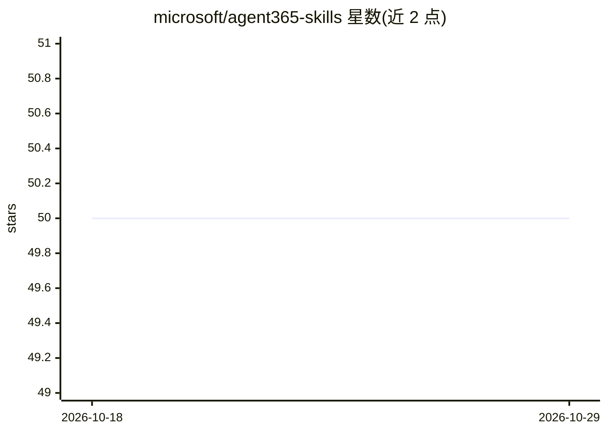

# microsoft/agent365-skills

⭐ 50 · JavaScript · MIT · 推送 2026-10-21 · [GitHub](https://github.com/microsoft/agent365-skills) · 组织维护

**面向 Microsoft Agent 365 的 AI 编程技能与 MCP 配置集**

由 Microsoft 维护的 agent 技能与 MCP 配置仓库，兼容 Claude Code 与 GitHub Copilot。提供七个技能覆盖 Agent 365 生命周期：把 agent 转换为具备 M365 身份的 AI Teammate、注册 Blueprint、接入 WorkIQ MCP 服务器（邮件/日历/Teams/SharePoint 等工具）、OTel 可观测性埋点、代码校验与 AgentsPlayground 本地测试。推荐经 a365-setup 入口技能检测 agent 技术栈并分派，需 Microsoft Agent 365 租户、a365 CLI 与 Azure CLI 等前置条件。

## 筛选速览

| 维度 | 判定 | 备注 |
|---|---|---|
| AI 角色 | `ai-ecosystem` | LLM/agent 周边工具 |
| 许可风险 | `permissive` | MIT |
| 部署形态 | `None` |  |
| 模型依赖 | — | README 未给出锁定关系 |
| 硬件要求 | — | 无带数字的原话,不猜 |
| 安装摩擦 | `medium` | 含编译或系统依赖之一 |
| 成熟度 | — | 结构信号不足 |

## 能力要点

- 七个技能覆盖 A365 注册、AI Teammate 转换、WorkIQ MCP、可观测性等生命周期环节
- 支持 Claude Code 插件市场、GitHub Copilot CLI、VS Code agent mode 多种安装途径
- a365-setup 检测 agent 技术栈（Node.js/.NET/Python）并以本地缓存文件避免重复检测

## 适用场景

- 把现有 agent 转换为带 Teams 身份的 AI Teammate 并发布
- 为 agent 接入 Microsoft 365 的 WorkIQ MCP 工具
- 为 agent 添加可观测性埋点并注册到 Agent 365 目录

## 场景标签

 · 领域:企业 Agent 开发/DevTools

## 证据(README 行号)

> L6: Agent skills and MCP configuration for Microsoft Agent 365 — works with Claude Code and GitHub Copilot. Skills cover
> L14: - **a365 CLI** — `dotnet tool install -g Microsoft.Agents.A365.DevTools.Cli`

## 星数曲线

2026-10-18 50 → 2026-10-29 50（+0）

---
*卡片 v1 · prompt 1.4 · 生成 2026-10-24 · 置信度 high · 依据 README sha `bad159acb4a2` · [字段定义](../../DATASET.md)*
