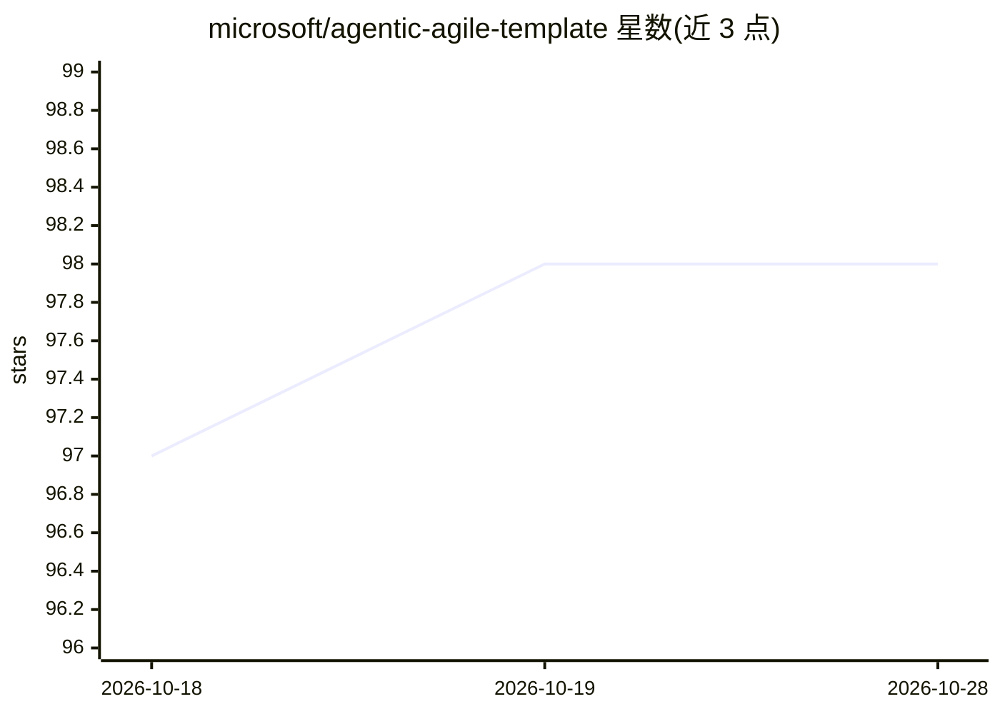

# microsoft/agentic-agile-template

⭐ 98 · MIT · 推送 2026-10-22 · [GitHub](https://github.com/microsoft/agentic-agile-template) · 组织维护

**面向团队的人机协作软件开发方法论模板（Agentic-Agile）**

微软维护的起步模板仓库，实践 Agentic-Agile 开发方法论：通过结构化人机协作产出生产级软件。核心观点是 agent 失败源于协调而非模型能力，故以规格说明为程序。提供通用引导文件 AGENTS.md（6 步 onboarding 对话）、三层平台适配器（agent 工具约定、issue 跟踪、CI/CD）、agentic-story issue 模板、史诗分解示例、wave 并行执行流程与八维评估框架，附 MCP 服务器配置示例。通过 GitHub 'Use this template' 复制使用，README 明示该方法论仍为活跃研究区，结果具有非确定性。

## 筛选速览

| 维度 | 判定 | 备注 |
|---|---|---|
| AI 角色 | `ai-ecosystem` | LLM/agent 周边工具 |
| 许可风险 | `permissive` | MIT |
| 部署形态 | `None` |  |
| 模型依赖 | — | README 未给出锁定关系 |
| 硬件要求 | — | 无带数字的原话,不猜 |
| 安装摩擦 | `low` | 无编译、无系统依赖或容器化 |
| 成熟度 | `idea` | |

## 能力要点

- AGENTS.md 引导 6 步 onboarding 对话，按需激活平台适配器
- 三层平台适配器：agent 工具、issue 跟踪、CI/CD 各自独立可换
- agentic-story issue 模板：范围、文件所有权、验收标准
- 八维人机协作效果测量框架与 MCP 服务器配置示例

## 适用场景

- 团队用模板仓库起步，将 AI 编码 agent 纳入结构化敏捷流程
- 按 wave 并行执行将独立 story 分派给多个 agent 开发
- 度量 agent 产出质量（合并冲突、首次验收率、逃逸缺陷）

## 场景标签

`编码 Agent` `多智能体` · 领域:Agent 开发

## 证据(README 行号)

> L6: A starter template for teams adopting Agentic-Agile Development: the practice of producing production-ready software
> L14: Agentic-Agile Development provides the process layer that makes agent collaboration repeatable: structured backlogs

## 星数曲线

2026-10-18 97 → 2026-10-28 98（+1）

---
*卡片 v1 · prompt 1.4 · 生成 2026-10-23 · 置信度 high · 依据 README sha `ef2c95207176` · [字段定义](../../DATASET.md)*
