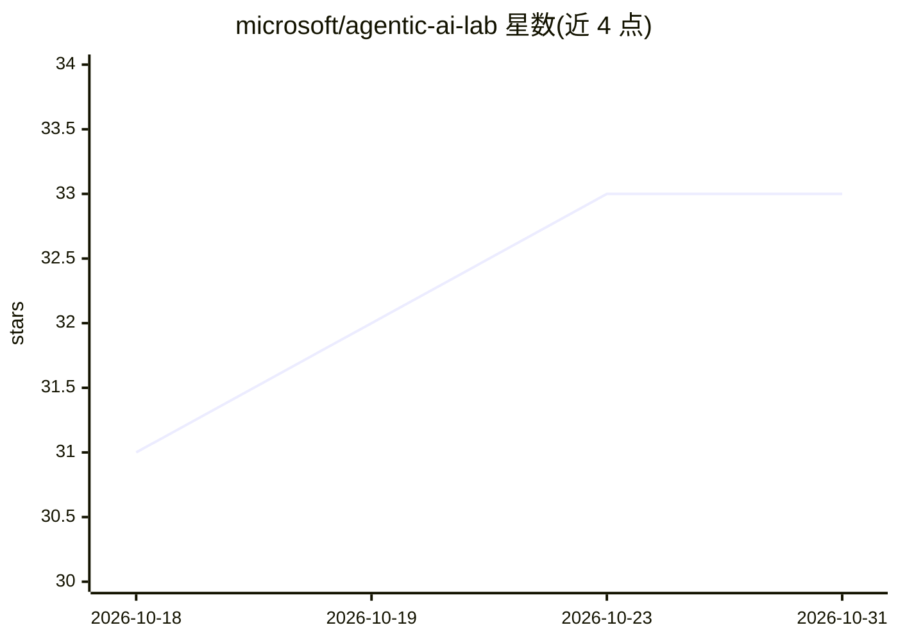

# microsoft/agentic-ai-lab

⭐ 33 · Jupyter Notebook · MIT · 推送 2025-12-12 · [GitHub](https://github.com/microsoft/agentic-ai-lab) · 组织维护

**Azure AI Foundry 与 AI Agent 开发实战工作坊（教程/实验仓库）**

Microsoft 维护的端到端动手实验仓库，以渐进式 Jupyter Notebook 与实现示例教授 Azure AI Foundry 平台的用法：覆盖认证与环境配置、Chat/RAG、AI Agent（File Search、Bing Grounding、Azure Functions、多 Agent）、MCP 集成、AI 红队安全测试、Microsoft Agent Framework（含中间件、工作流、上下文提供者）、可观测性与评测、低代码语言/视觉服务、内容理解与责任 AI 共约 11 个模块。需自备 Azure 订阅，创建 AI Foundry 资源并部署 gpt-4o 等模型，Python 3.10+，通过 git clone 与 pip 安装依赖运行。

## 筛选速览

| 维度 | 判定 | 备注 |
|---|---|---|
| AI 角色 | `ai-knowledge` | 知识聚合/清单类 |
| 许可风险 | `permissive` | MIT |
| 部署形态 | `library` | 以包/库形式分发 |
| 模型依赖 | — | README 未给出锁定关系 |
| 硬件要求 | — | 无带数字的原话,不猜 |
| 安装摩擦 | `low` | 无编译、无系统依赖或容器化 |
| 成熟度 | — | 结构信号不足 |

## 能力要点

- 约 11 个渐进式模块覆盖 RAG、Agent、MCP、红队测试与评测
- 含 MCP 库存管理 Agent 与 AI 红队测试等完整可运行实现
- Microsoft Agent Framework 章节：工作流、中间件、检查点、人机协同
- 需要 Azure 订阅与 AI Foundry 资源，部署 gpt-4o 等模型

## 适用场景

- 系统学习 Azure AI Foundry 与 Agent 开发
- 查找 MCP、多 Agent、红队测试的参考实现
- 团队开展一天制的 AI 实战培训

## 场景标签

`教程课程` · 领域:学习与行业

## 证据(README 行号)

> L9: *Master Azure AI Foundry and Agents through hands-on experimentation and real-world applications*
> L121: ## 📚 Learning Path
> L125: ### 🎯 Phase 1: Foundation (Start Here)

## 星数曲线

2026-10-18 31 → 2026-10-31 33（+2）

---
*卡片 v1 · prompt 1.4 · 生成 2026-10-25 · 置信度 high · 依据 README sha `65a9af9eabe4` · [字段定义](../../DATASET.md)*
