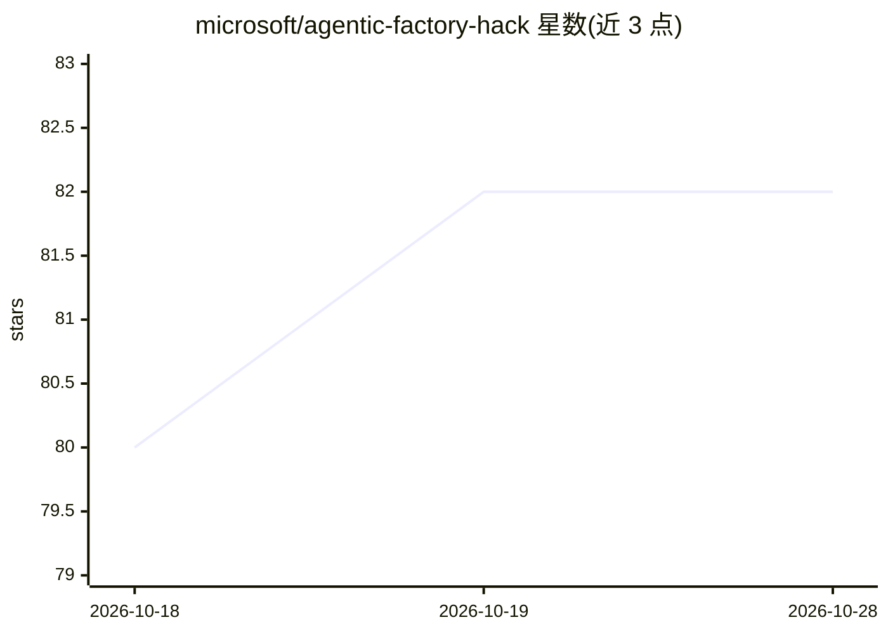

# microsoft/agentic-factory-hack

⭐ 85 · Python · MIT · 推送 2026-10-23 · [GitHub](https://github.com/microsoft/agentic-factory-hack) · 组织维护

**微软 predictive maintenance 多智能体黑客松教程仓库**

微软主办的智能预测性维护黑客松学习仓库：以虚构轮胎制造厂为场景，指导参与者用 Microsoft Agent Framework、Microsoft Foundry 与 Azure 搭建五个 agent（异常分类、故障诊断、维修规划、排程、备件订购），经 Aspire 顺序编排并支持 A2A 通信，配合 API Management/MCP、Foundry IQ 知识源、Cosmos DB 与 Application Insights。共 5 个递进挑战，需 Azure 订阅（Owner 权限）与 GitHub 账号，通过 Codespaces 提供容器化开发环境，主要使用 Python 与 .NET。仓库本身为文档与起步代码，不提供部署版产品。

## 筛选速览

| 维度 | 判定 | 备注 |
|---|---|---|
| AI 角色 | `ai-knowledge` | 知识聚合/清单类 |
| 许可风险 | `permissive` | MIT |
| 部署形态 | `None` |  |
| 模型依赖 | — | README 未给出锁定关系 |
| 硬件要求 | — | 无带数字的原话,不猜 |
| 安装摩擦 | `low` | 无编译、无系统依赖或容器化 |
| 成熟度 | — | 结构信号不足 |

## 能力要点

- 五个 agent（异常分类/故障诊断/维修规划/排程/备件订购）的构建与编排教程
- Microsoft Agent Framework 顺序编排 + Aspire 本地运行与 A2A 通信
- MCP 工具调用接入、Foundry 持久化记忆、Application Insights 可观测性
- 5 个递进挑战结构（环境搭建到多智能体编排）

## 适用场景

- 学习制造业场景下的多智能体 workflow 设计与编排模式
- 实践 Microsoft Foundry / Agent Framework 的 agent 开发与工具集成
- 通过 Codespaces 免本地配置完成端到端 agent 工作流实验

## 场景标签

`Agent 框架` `多智能体` `教程课程` · 领域:Agent 开发

## 证据(README 行号)

> L1: # Intelligent Predictive Maintenance Hackathon
> L3: Welcome to the Intelligent Predictive Maintenance Hackathon. In this workshop you’ll explore how AI agents can suppo
> L110: This hackathon is divided into five challenges, each building on the previous one. You'll start by setting up your

## 星数曲线

2026-10-18 80 → 2026-10-28 82（+2）

---
*卡片 v1 · prompt 1.4 · 生成 2026-10-24 · 置信度 high · 依据 README sha `e614f15b6301` · [字段定义](../../DATASET.md)*
