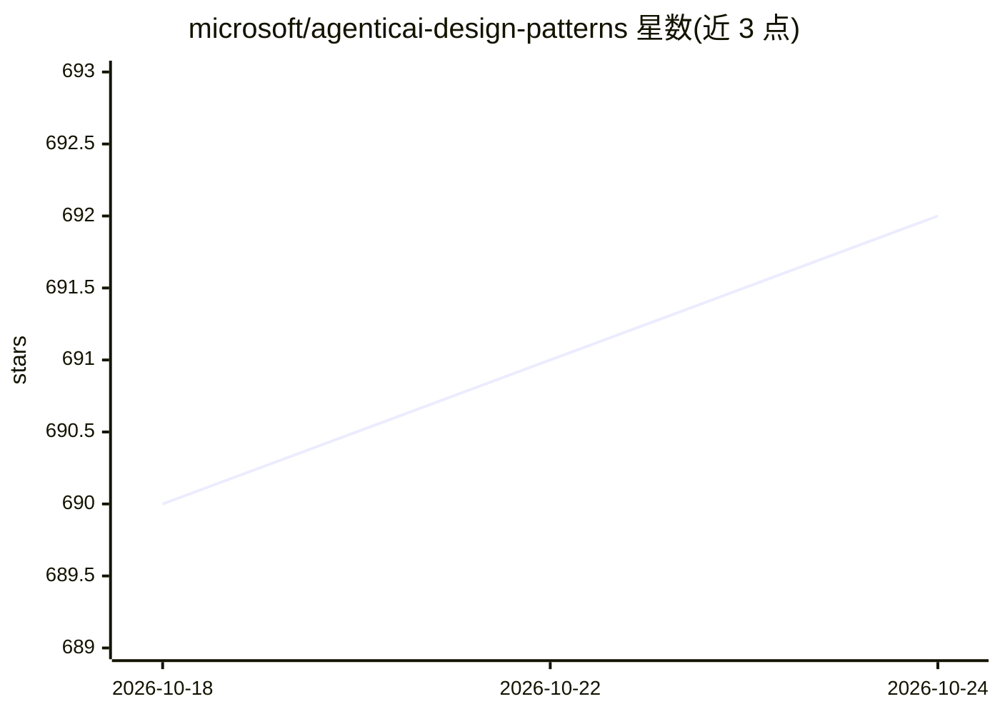

# microsoft/agenticai-design-patterns

⭐ 691 · Python · MIT · 推送 2026-10-21 · [GitHub](https://github.com/microsoft/agenticai-design-patterns) · 组织维护

**面向 Azure/Microsoft Foundry 的 Agentic AI 设计模式与参考架构清单**

微软维护的仓库，收录从实地项目中归纳的领域无关 Agentic AI 资产：设计模式、参考架构、方案加速器与交付 playbook，覆盖六大生产化支柱（治理与 CoE、Landing Zone、Agent Ops、安全与可观测性、方案优化、架构模式）。资产经策展人审核后合并，遵循统一目录结构并携带机器可读的 manifest.yaml，目录与支柱表由 python scripts/assets.py catalog 从 manifest 生成。资产多为 preview/experimental 成熟度，主要面向微软技术栈（Microsoft Foundry、Entra、API Management、M365 Copilot）。

## 筛选速览

| 维度 | 判定 | 备注 |
|---|---|---|
| AI 角色 | `ai-knowledge` | 知识聚合/清单类 |
| 许可风险 | `permissive` | MIT |
| 部署形态 | `None` |  |
| 模型依赖 | — | README 未给出锁定关系 |
| 硬件要求 | — | 无带数字的原话,不猜 |
| 安装摩擦 | `low` | 无编译、无系统依赖或容器化 |
| 成熟度 | — | 结构信号不足 |

## 能力要点

- 按六大生产化支柱组织的资产目录（治理/Landing Zone/Agent Ops/安全/优化/架构）
- 每个资产携带机器可读的 manifest.yaml，目录由脚本自动生成
- 覆盖 MCP 网关、OAuth 前门、代码沙箱、确定性验证等具体模式
- 资产分 design-pattern/reference-architecture/solution-accelerator/playbook 四类并标注成熟度

## 适用场景

- 把 Agentic AI 项目从试点推进到生产时查找对应支柱的模式与架构
- 企业构建安全的 agent 平台（工具治理、身份传播、多租户 MCP 网关）
- 选型 Foundry prompt agents 与 hosted agents 时使用决策矩阵
- 了解微软生态下 agent 生产化的参考做法

## 场景标签

`精选清单` · 领域:学习与行业

## 证据(README 行号)

> L3: Field-proven design patterns, reference architectures, solution accelerators and delivery playbooks for taking agent
> L5: Every asset is generalized from repeated field work into a domain-agnostic pattern, reviewed by a curator before mer

## 星数曲线

2026-10-18 690 → 2026-10-24 692（+2）

---
*卡片 v1 · prompt 1.4 · 生成 2026-10-21 · 置信度 high · 依据 README sha `b8ed74085b3a` · [字段定义](../../DATASET.md)*
