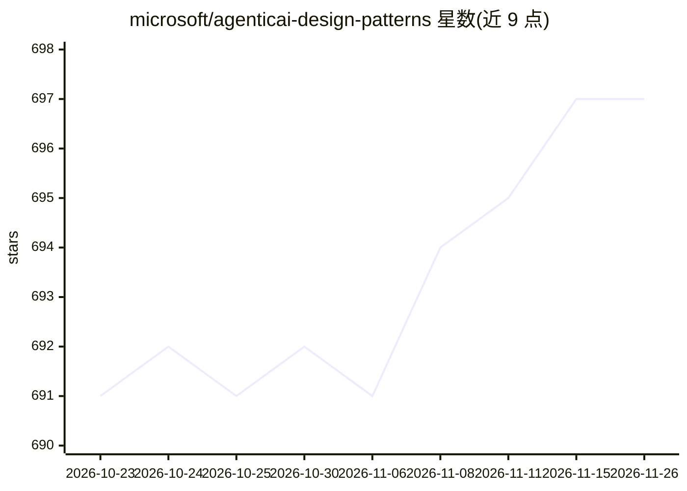

# microsoft/agenticai-design-patterns

⭐ 697 · Python · MIT · 推送 2026-11-05 · [GitHub](https://github.com/microsoft/agenticai-design-patterns) · 组织维护

**面向企业开发者的 Azure 上的 Agentic AI 设计模式目录**

由 Microsoft 维护的开源目录，将真实实现抽象为与领域无关的 agentic AI 设计模式、参考架构与解决方案加速器，按 M365 集成、安全治理、基础设施、Agent 运行时、AI 网关、编排工作流六类组织。每条资产附权衡说明与不适用场景、可运行样例及离线自测、机器可读的 manifest.yaml，合并前经维护者逐一审核。面向在 Azure 与 Microsoft Foundry 上构建生产级 agent 系统的团队。

## 筛选速览

| 维度 | 判定 | 备注 |
|---|---|---|
| AI 角色 | `ai-knowledge` | 知识聚合/清单类 |
| 许可风险 | `permissive` | MIT |
| 部署形态 | `None` |  |
| 模型依赖 | — | README 未给出锁定关系 |
| 硬件要求 | — | 无带数字的原话,不猜 |
| 安装摩擦 | `low` | 无编译、无系统依赖或容器化 |
| 成熟度 | — | 结构信号不足 |

## 能力要点

- 六类组织的设计模式/参考架构/加速器目录，条目标注 maturity
- 每条资产带可运行样例与离线自测（simulator/self-test）
- 机器可读 manifest.yaml 支持检索工具发现
- 说明权衡与不适用场景，合并前人工审核

## 适用场景

- 在 Azure/Foundry 上规划企业级 agent 架构时查参考模式
- 设计 MCP 网关的多租户权限与配额方案
- 决策 prompt agent 还是 hosted agent 的选型
- 为 agent 代码执行设计沙箱与生命周期

## 场景标签

`精选清单` · 领域:学习与行业

## 证据(README 行号)

> L3: An open catalog of agentic AI design patterns, reference architectures and solution accelerators for building produc
> L5: Each asset is generalized from real implementations into a domain-agnostic pattern, explains its trade-offs and when
> L7: ## Catalog

## 星数曲线

2026-10-23 691 → 2026-11-26 697（+6）

---
*卡片 v1 · prompt 1.4 · 生成 2026-11-24 · 置信度 high · 依据 README sha `78e0426c1cc8` · [字段定义](../../DATASET.md)*
