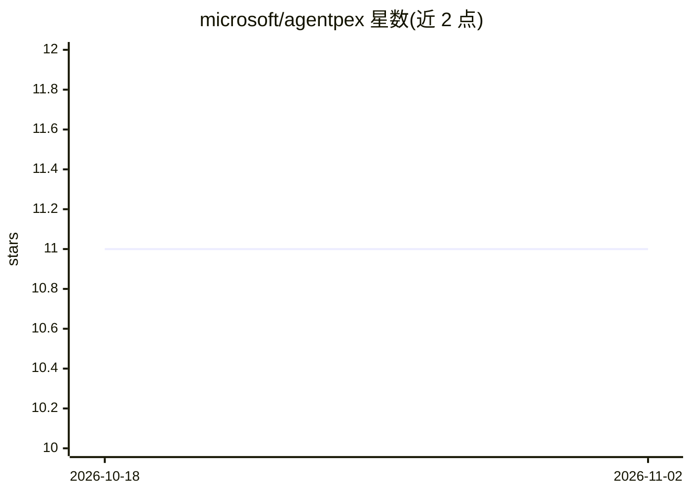

# microsoft/agentpex

⭐ 11 · Python · NOASSERTION · 推送 2026-04-29 · [GitHub](https://github.com/microsoft/agentpex) · 组织维护

**开发者用的 agent 轨迹导入与评测工具，对轨迹做规范抽取与评分**

从多种格式（标准 JSON、tau-sq、Langfuse、Langtrace）导入 agent 轨迹，从系统提示与工具 schema 中抽取规范（输出规范、迁移规范、禁止边），再做增强（plan/init_state/fini_state），随后以 CLI 或 pip API 运行 8 个 LLM 评判的评测器并输出评分与汇总报告。各组件的 LLM（规范抽取、计划生成、各评测器）可按环境变量分别指定 provider:model，支持 openai/azure/ollama（OpenAI 兼容端点）。提供 Langfuse 与 Langtrace 双向集成（拉取轨迹、回推评分）及端到端冒烟测试脚本。以源码方式安装（pip install -r requirements.txt 或 pip install -e .），尚无独立安装包。

## 筛选速览

| 维度 | 判定 | 备注 |
|---|---|---|
| AI 角色 | `ai-ecosystem` | LLM/agent 周边工具 |
| 许可风险 | `none` | NOASSERTION |
| 部署形态 | `library` | 以包/库形式分发 |
| 模型依赖 | local-ok | 支持本地模型 |
| 硬件要求 | — | 无带数字的原话,不猜 |
| 安装摩擦 | `low` | 无编译、无系统依赖或容器化 |
| 成熟度 | — | 结构信号不足 |

## 能力要点

- 从系统提示与工具 schema 抽取规范并增强轨迹（plan/init_state/fini_state）
- 8 个 LLM 评判评测器，各组件模型可按环境变量分别覆盖
- Langfuse / Langtrace 集成：拉取轨迹、评测并回推评分
- 提供 tau-sq 格式导入与端到端冒烟测试脚本

## 适用场景

- 导入已记录的 agent 轨迹并自动生成评测规范
- 在 Langfuse/Langtrace 看板中查看 AgentPex 评分
- 对本地 Ollama 模型快速跑通评测冒烟测试

## 场景标签

`模型评测` `LLM 可观测性` · 领域:评测与运维

## 证据(README 行号)

> L3: AgentPex imports agent traces from various formats and evaluates them against specifications extracted from system p
> L40: Or use the same artifact directory path for `--input-test-result`. Evaluation runs the LLM-judged evaluators and wr

## 星数曲线

2026-10-18 11 → 2026-11-02 11（+0）

---
*卡片 v1 · prompt 1.4 · 生成 2026-11-02 · 置信度 high · 依据 README sha `fc6b01d94244` · [字段定义](../../DATASET.md)*
