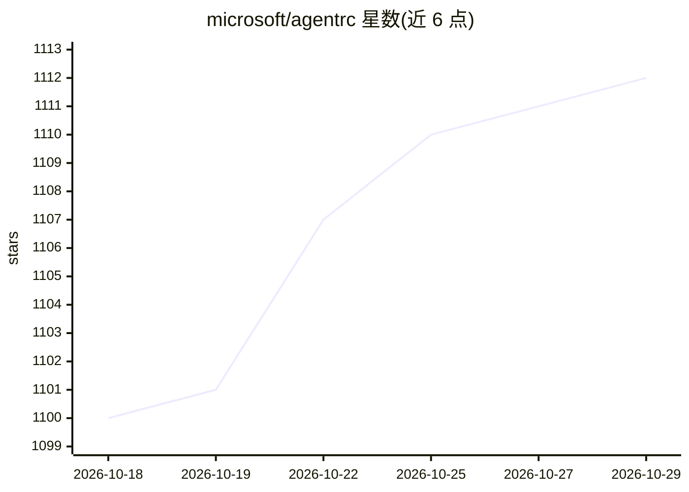

# microsoft/agentrc

⭐ 1,112 · TypeScript · MIT · 推送 2026-10-28 · [GitHub](https://github.com/microsoft/agentrc) · 组织维护

**为 AI 编码 agent 生成并维护仓库上下文配置的工具**

微软维护的 CLI/VS Code 扩展：读取代码库，按 9 个维度和 5 级成熟度评分仓库的 AI 就绪度，基于 Copilot SDK 生成定制化的指令文件（如 copilot-instructions.md、AGENTS.md）、MCP 配置与评测用例，并可在 CI 中评测指令是否仍有效以监控漂移。支持 GitHub 与 Azure DevOps、monorepo、批量处理与 PR 自动化；需 Node.js 22+。项目声明为实验性、可能有不兼容变更。

## 筛选速览

| 维度 | 判定 | 备注 |
|---|---|---|
| AI 角色 | `ai-ecosystem` | LLM/agent 周边工具 |
| 许可风险 | `permissive` | MIT |
| 部署形态 | `library` | 以包/库形式分发 |
| 模型依赖 | — | README 未给出锁定关系 |
| 硬件要求 | — | 无带数字的原话,不猜 |
| 安装摩擦 | `low` | 无编译、无系统依赖或容器化 |
| 成熟度 | `idea` | |

## 能力要点

- 9 维度 AI 就绪度评分与 5 级成熟度模型
- 基于 Copilot SDK 读取实际代码生成指令文件与 MCP 配置（非模板）
- CI 中运行 eval 检测上下文漂移，支持 readiness 质量门禁
- 支持 GitHub / Azure DevOps、monorepo、org 级批量与自动 PR

## 适用场景

- 为 AI 编码 agent 补齐仓库的构建/测试/架构上下文文件
- 在 CI 中持续监控 agent 指令是否随代码演进失效
- 跨组织批量评估和提升各仓库的 AI 就绪度

## 场景标签

`模型评测` `提示工程` · 领域:Agent 开发

## 证据(README 行号)

> L3: **Context engineering for AI coding agents.**
> L13: AgentRC reads your codebase and generates the files that close that gap — then evaluates whether they actually help
> L35: Produce tailored instruction files, evals, and dev configs via the Copilot SDK. No templates — AgentRC reads your a

## 星数曲线

2026-10-18 1,100 → 2026-10-29 1,112（+12）

---
*卡片 v1 · prompt 1.4 · 生成 2026-10-21 · 置信度 high · 依据 README sha `9bd83fa5e065` · [字段定义](../../DATASET.md)*
