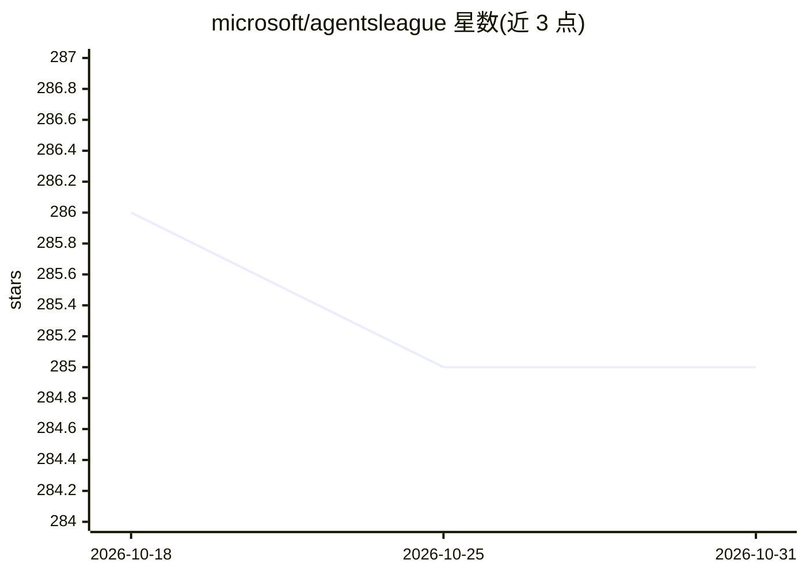

# microsoft/agentsleague

⭐ 285 · MIT · 推送 2026-08-24 · [GitHub](https://github.com/microsoft/agentsleague) · 组织维护

**微软主办的两周 AI agent 开发者竞赛（已结束）**

Microsoft 在 GitHub 举办的 Agents League 开发者挑战赛仓库：2026 年 2 月 16 日至 3 月 1 日的两周赛事，设 Creative Apps（GitHub Copilot）、Reasoning Agents（Microsoft Foundry）、Enterprise Agents（M365 Agents Toolkit）三条赛道，参赛者通过 issue 模板提交项目，由专家按 6 项标准评分并有社区投票。仓库提供 starter-kits/ 目录的配置指南与示例，README 顶部声明比赛已结束并链接获奖公告。

## 筛选速览

| 维度 | 判定 | 备注 |
|---|---|---|
| AI 角色 | `ai-knowledge` | 知识聚合/清单类 |
| 许可风险 | `permissive` | MIT |
| 部署形态 | `None` |  |
| 模型依赖 | — | README 未给出锁定关系 |
| 硬件要求 | — | 无带数字的原话,不猜 |
| 安装摩擦 | `low` | 无编译、无系统依赖或容器化 |
| 成熟度 | — | 结构信号不足 |

## 能力要点

- 三条赛道分别对应 GitHub Copilot / Microsoft Foundry / M365 Agents Toolkit
- 通过仓库 issue 模板提交项目，截止 2026 年 3 月 1 日
- starter-kits/ 目录提供各赛道配置指南与示例
- 评分含准确性、推理、创意、体验、可靠性五项加社区投票

## 适用场景

- 查阅赛事流程与提交规则
- 浏览 starter-kits 获取三类工具的入门指南
- 查看获奖公告与全部提交项目

## 场景标签

 · 领域:开发者社区/竞赛

## 证据(README 行号)

> L9: **A 2-week AI developer challenge running between February 16 - March 1, 2026 with live coding battles, community bu
> L32: |Track|Tool|Challenge|Starter Kit|
> L135: ### 📦 Starter Kits (with setup guides & examples)

## 星数曲线

2026-10-18 286 → 2026-10-31 285（-1）

---
*卡片 v1 · prompt 1.4 · 生成 2026-10-22 · 置信度 high · 依据 README sha `33972d22b787` · [字段定义](../../DATASET.md)*
