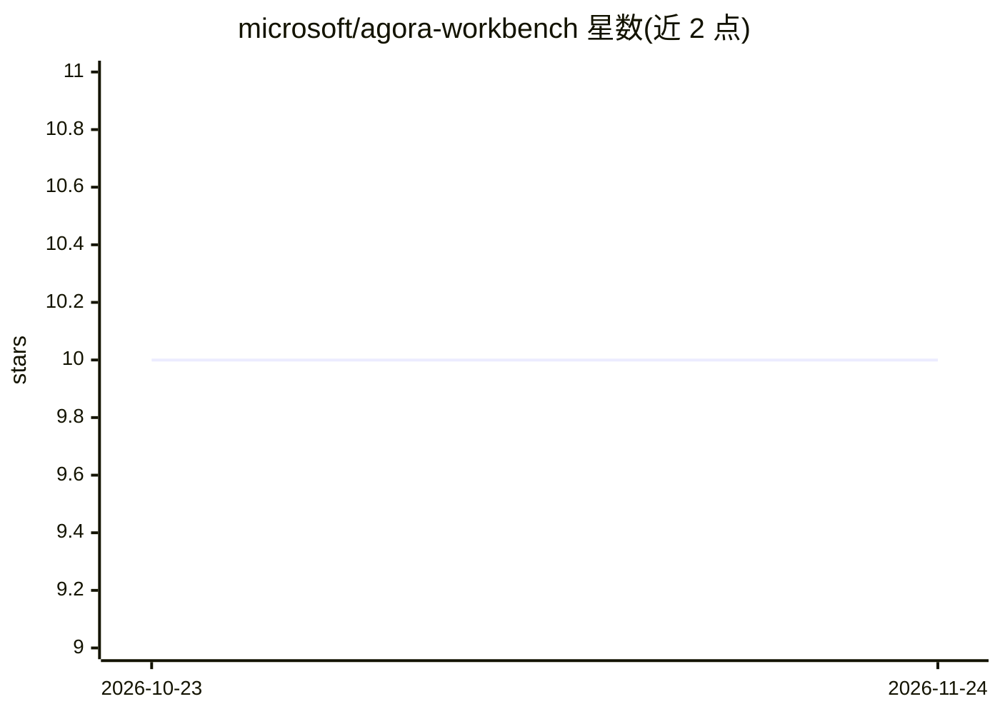

# microsoft/agora-workbench

⭐ 10 · Python · MIT · 推送 2026-11-13 · [GitHub](https://github.com/microsoft/agora-workbench) · [官网](https://microsoft.github.io/agora-workbench) · 组织维护

**给开发者的 MCP 服务器构建工具：把 Python 工具封装为沙箱执行服务**

用于构建 MCP 服务器的工具集，将领域相关的 Python 工具封装为隔离的、会话感知的执行环境，供任何 MCP 兼容客户端调用；提供可搜索的工具/技能目录（基础版为 SQLite FTS5 关键词检索，向量检索需装 extra）、附带数据文件的目录，以及基于 Bicep 模板和 CLI 部署到 Azure Container Apps 的路径。面向想把自己的 Python 工具以 MCP 形式暴露给 agent 的开发者。为研究性质软件，非 Microsoft 官方支持产品，维护无保证。

## 筛选速览

| 维度 | 判定 | 备注 |
|---|---|---|
| AI 角色 | `ai-ecosystem` | LLM/agent 周边工具 |
| 许可风险 | `permissive` | MIT |
| 部署形态 | `library` | 以包/库形式分发 |
| 模型依赖 | locked-api |  |
| 硬件要求 | — | 无带数字的原话,不猜 |
| 安装摩擦 | `low` | 无编译、无系统依赖或容器化 |
| 成熟度 | `idea` | |

## 能力要点

- 将领域 Python 工具封装为隔离、会话感知的 MCP 执行服务器
- 工具与技能注册进可搜索目录，agent 可自然语言查询
- 文件目录随代码一起提供，agent 无需硬编码路径即可加载数据集
- 含 Bicep 模板与部署 CLI，支持 Entra ID 认证部署到 Azure Container Apps

## 适用场景

- 把团队已有的 Python 工具封装成 MCP 服务器供 agent 调用
- 为多个 agent 提供统一的沙箱 Python 代码执行环境
- 搭一个让 agent 自然语言检索工具与数据集的目录

## 场景标签

`Agent 框架` · 领域:Agent 开发

## 证据(README 行号)

> L22: Agora Workbench is a toolkit for building MCP (Model Context Protocol) servers that provide sandboxed Python execut
> L26: - **Wrap domain-specific Python tooling as MCP servers** — expose Python environments through isolated, session-awa

## 星数曲线

2026-10-23 10 → 2026-11-24 10（+0）

---
*卡片 v1 · prompt 1.4 · 生成 2026-11-19 · 置信度 high · 依据 README sha `1c043f674155` · [字段定义](../../DATASET.md)*
