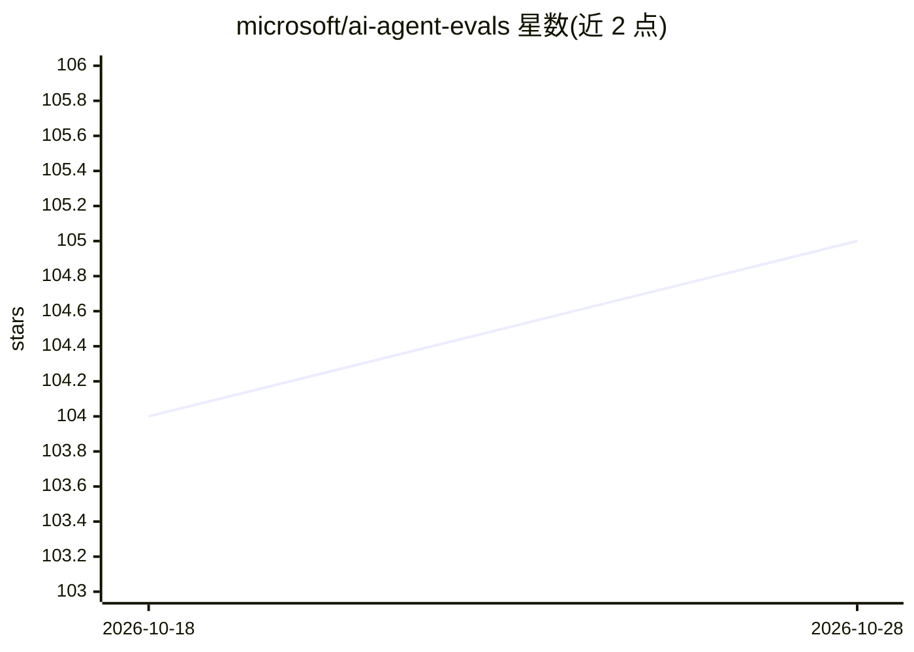

# microsoft/ai-agent-evals

⭐ 105 · Python · MIT · 推送 2026-05-20 · [GitHub](https://github.com/microsoft/ai-agent-evals) · 组织维护

**在 CI/CD 中离线评测 Microsoft Foundry AI Agent 的 GitHub Action**

微软维护的 GitHub Action，面向使用 Microsoft Foundry Agent 服务的团队：在 CI/CD 流水线中对 agent 做发布前离线评测。用户提供含测试查询的 JSON 数据集与评测器列表，Action 调用 agent、采集延迟与 token 计数、运行评测并生成汇总报告。支持 Foundry 评测器目录中的 agent/RAG/风险安全/通用评测器、OpenAI grader 及 Python 或 LLM-as-a-judge 自定义评测器；结果含置信区间与统计显著性检验，可对比多个 agent 版本。限制：需 Microsoft Foundry 项目端点与 Azure AI 模型部署。

## 筛选速览

| 维度 | 判定 | 备注 |
|---|---|---|
| AI 角色 | `ai-ecosystem` | LLM/agent 周边工具 |
| 许可风险 | `permissive` | MIT |
| 部署形态 | `None` |  |
| 模型依赖 | — | README 未给出锁定关系 |
| 硬件要求 | — | 无带数字的原话,不猜 |
| 安装摩擦 | `low` | 无编译、无系统依赖或容器化 |
| 成熟度 | — | 结构信号不足 |

## 能力要点

- CI/CD 中自动化评测 Microsoft Foundry agent，采集延迟与 token 数据
- 支持 agent/RAG/风险安全/通用/OpenAI grader/自定义六类评测器
- 结果含置信区间与统计显著性检验，可多 agent 版本对比

## 适用场景

- 发布前在 CI 流水线中评估 agent 回答质量与安全性
- 对比新旧 agent 版本确定改动是否有统计意义
- 对 RAG 系统端到端与检索过程做评测

## 场景标签

`模型评测` · 领域:评测与运维

## 证据(README 行号)

> L3: This GitHub Action enables offline evaluation of Microsoft Foundry Agents within your CI/CD pipelines. It is designe
> L5: To use this action, all you need to provide is a data set with test queries and a list of evaluators. This action wi

## 星数曲线

2026-10-18 104 → 2026-10-28 105（+1）

---
*卡片 v1 · prompt 1.4 · 生成 2026-10-23 · 置信度 high · 依据 README sha `f42e07149d52` · [字段定义](../../DATASET.md)*
